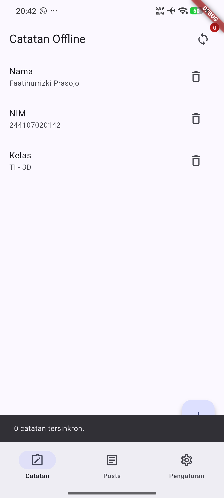
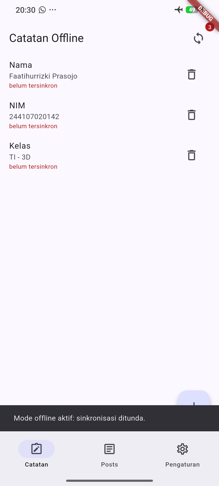
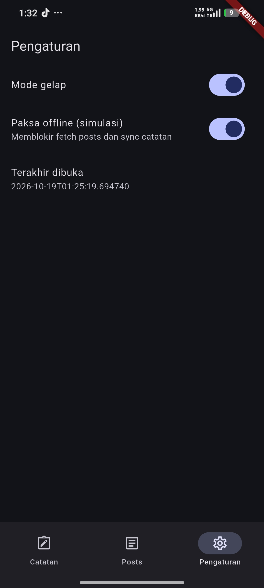

# Minggu 5 - Local Storage Offline First

**Nama:** Faatihurrizki Prasojo

**NIM:** 244107020142

## Tujuan 
- Menjelaskan perbedaan penyimpanan key-value, relasional, dan NoSQL di perangkat;
- Menyimpan preferensi sederhana (tema, terakhir dibuka) dengan SharedPreferences;
- Menerapkan CRUD catatan dengan SQLite (sqflite) melalui repository lokal;
- Menerapkan pola offline-first: cache-first read, dirty flag, dan antrean sinkronisasi;
- Menampilkan state loading, error, empty, dan success untuk data lokal dengan Riverpod;
- Menguji repository lokal dengan repository palsu (tanpa database sungguhan).

#### Dokumentasi Praktikum
| Home | No Internet | Dark Mode |
| :---: | :---: |:---: |
|  |  |  |


## AI Challenge (Claude AI)
#### Temuan Utama

Proyek ini sudah memakai SharedPreferences dan sqflite, jadi rekomendasi final di bawah sama dengan yang sudah diterapkan. Drift lebih unggul di 4 dari 6 kriteria, tetapi untuk aplikasi sekecil ini keuntungannya tidak menutup biaya setup-nya.

Ada dua bug di kode yang lebih berbahaya daripada pilihan library:

1. `deleteNote` memakai hard delete, sehingga catatan yang dihapus tidak pernah masuk antrean sync. Server tidak akan tahu catatan itu sudah dihapus. [Pasti, dari `note_repository.dart`]
2. `updated_at` disimpan lewat `DateTime.now().toIso8601String()`, yaitu waktu lokal tanpa offset. Urutan catatan dan `markSynced` bisa kacau kalau zona waktu perangkat berubah. [Pasti]

Keduanya dibahas lagi di bagian skema.

#### 1. Perbandingan per Kriteria

| Kriteria | SharedPreferences | Hive (CE) | sqflite | Drift |
|---|---|---|---|---|
| Kompleksitas query | Tidak ada. Hanya get/set per key | Ambil per key atau iterasi box. Filter dan sort dilakukan di Dart | Penuh (SQL: WHERE, ORDER, JOIN, agregasi), tapi ditulis sebagai string | Penuh, ditulis lewat Dart API atau SQL yang divalidasi saat generate |
| Kebutuhan relasi | Tidak bisa | Tidak ada. Relasi harus disimpan manual sebagai key | Foreign key dan JOIN native | Foreign key dan JOIN native, bertipe |
| Reaktivitas (stream) | Tidak ada bawaan | Ada (`box.watch()`, `listenable()`) | Tidak ada. Harus `invalidate` provider manual, seperti di kodemu | Bawaan (`.watch()`), otomatis emit saat tabel berubah |
| Type-safety | Hanya int, double, bool, String, List<String> | Bertipe lewat adapter hasil generate | Rendah. `Map<String, Object?>` dan string key (`'updated_at'`), typo baru ketahuan saat runtime | Tinggi. Kolom dan query diperiksa saat compile |
| Boilerplate | Paling kecil | Sedang (adapter, `build_runner`) | Sedang. `toMap`/`fromMap` ditulis manual | Terbesar di awal (`drift`, `drift_flutter`, `drift_dev`, `build_runner`), paling kecil saat fitur bertambah |
| Kemudahan testing | Mudah (`setMockInitialValues`) | Mudah (folder temp) | Perlu fake repository (seperti `FakeNoteRepository`) atau `sqflite_common_ffi` | Paling mudah. `NativeDatabase.memory()` menjalankan SQL asli di memori |

Sumber untuk bagian paket: dokumentasi [shared_preferences](https://pub.dev/documentation/shared_preferences/latest/), halaman [hive_ce](https://pub.dev/packages/hive_ce/versions/2.8.0), dan [Drift getting started](https://drift.simonbinder.eu/getting-started/). Sel lain berasal dari pengetahuan umum tentang paket-paket ini. [Pasti]

#### 2. Rekomendasi Final

| Kebutuhan | Pilihan | Alasan | Yang dikorbankan |
|---|---|---|---|
| Preferensi (tema, last opened) | SharedPreferences, pakai `SharedPreferencesWithCache` | Datanya hanya 2 key primitif. Tidak butuh query, relasi, atau stream. Versi dengan cache bisa dibaca sinkron setelah init, jadi tema tidak berkedip saat startup | Tidak reaktif, harus dibungkus Notifier. Bukan untuk data penting |
| Catatan | sqflite | Butuh `ORDER BY`, filter `dirty`, dan transaksi. Pola offline-first di kode (dirty flag, antrean FIFO, `markSynced` dengan `WHERE updated_at = ?`) memang berbasis SQL. Tujuan README juga menyebut sqflite. Tanpa codegen | Tanpa type-safety dan tanpa stream. Mapping manual |
| Tidak dipilih: Hive | Menyimpan seluruh box di memori, tanpa query dan relasi | Untuk antrean dirty dan sort harus menulis ulang yang sudah disediakan SQL | |
| Tidak dipilih: Drift | Secara teknis paling kuat untuk catatan | Setup `build_runner` dan migrasi ke `Table`/`Companion` tidak sebanding untuk 1 tabel | |

Kapan pilihan catatan harus berubah ke Drift: kalau ditambah tabel `tags` atau `folders` (relasi), atau UI harus update otomatis tanpa `invalidate`. Kalau yang dinilai adalah "paling modern dan type-safe", Drift lebih mudah dipertahankan di presentasi. Kalau yang dinilai adalah kesesuaian dengan codelab, sqflite. Pilihan sqflite di sini mengikuti tujuan di README. [Kemungkinan Besar] itu yang dinilai, karena tertulis eksplisit di tujuan.

Temuan tambahan: `PrefsRepository` memakai `SharedPreferences.getInstance()`. Dokumentasi menyebut API legacy itu "will be deprecated in the future" dan menyarankan `SharedPreferencesAsync` atau `SharedPreferencesWithCache` untuk pengguna baru. [Pasti] Belum rusak, tapi sebaiknya sekalian diganti.

#### 3. Trade-off per Pilihan

**SharedPreferences.** Setup nol dan cepat untuk nilai kecil. Dokumentasinya sendiri menyatakan plugin ini tidak untuk data penting, dan hanya mendukung tipe primitif plus `List<String>`. Memasukkan 1000 catatan sebagai JSON ke satu key membuat setiap perubahan menulis ulang seluruh blob. [Pasti]

**Hive.** Cepat untuk objek sederhana dan punya stream. Harganya: tidak ada query, tidak ada relasi, dan adapter harus dijaga kompatibel kalau field berubah. Paket `hive` asli sudah lama tidak aktif dan `hive_ce` adalah penerusnya yang drop-in. [Kemungkinan Besar] untuk status paket asli, karena halaman yang dibaca tidak menyebutnya. Sisa `hive_generator` di folder `.dart_tool` menandakan pernah dicoba, tapi tidak ada di `pubspec.yaml`, jadi tidak berpengaruh.

**sqflite.** Kontrol penuh dan ringan. Risikonya: query berupa string, mapping manual, dan tidak ada migrasi otomatis. Setiap perubahan skema harus ditulis sendiri di `onUpgrade`. SQLite juga tidak bisa mengubah tipe kolom lewat `ALTER`, jadi perubahan seperti `updated_at` TEXT menjadi INTEGER butuh rebuild tabel (lihat bagian 5).

**Drift.** Mengatasi semua kelemahan sqflite di tabel kriteria. Biayanya: 4 paket, file `.g.dart` hasil generate, dan kurva belajar DSL tabel. Untuk satu tabel `notes`, biaya itu belum terbayar. [Kemungkinan Besar]

#### 4. Skema untuk 1000+ Catatan (sqflite)

```sql
CREATE TABLE notes(
  id         INTEGER PRIMARY KEY AUTOINCREMENT,
  uuid       TEXT    NOT NULL UNIQUE,   -- id stabil untuk sync (id integer bisa bentrok antar perangkat)
  title      TEXT    NOT NULL,
  body       TEXT    NOT NULL DEFAULT '',
  created_at INTEGER NOT NULL,          -- epoch ms UTC, bukan string lokal
  updated_at INTEGER NOT NULL,          -- epoch ms UTC, juga dipakai sebagai versi di markSynced
  deleted_at INTEGER,                   -- NULL = aktif; terisi = tombstone, agar penghapusan ikut tersinkron
  dirty      INTEGER NOT NULL DEFAULT 0 CHECK (dirty IN (0,1))
);

-- Daftar utama: hanya catatan aktif, urut terbaru. Partial index jadi kecil.
CREATE INDEX idx_notes_list  ON notes(updated_at DESC, id DESC) WHERE deleted_at IS NULL;
-- Antrean sync: hanya baris dirty. countDirty() cukup membaca index ini.
CREATE INDEX idx_notes_dirty ON notes(updated_at) WHERE dirty = 1;
```

Query layar daftar dengan keyset pagination. Ambil `substr(body,1,120)` saja, bukan seluruh body:

```dart
// Halaman berikutnya: kursor = (updated_at, id) baris terakhir di layar.
// Pakai bentuk OR, bukan row-value ((a,b) < (?,?)), karena SQLite bawaan
// Android lama (< 3.15) tidak mendukung row-value.
final rows = await db.rawQuery('''
  SELECT id, title, substr(body, 1, 120) AS snippet, updated_at
  FROM notes
  WHERE deleted_at IS NULL
    AND (updated_at < ? OR (updated_at = ? AND id < ?))
  ORDER BY updated_at DESC, id DESC
  LIMIT 30
''', [lastUpdatedAt, lastUpdatedAt, lastId]);
```

Hapus catatan menjadi update, bukan `DELETE`:

```dart
await db.update('notes',
  {'deleted_at': nowMs, 'updated_at': nowMs, 'dirty': 1},
  where: 'id = ?', whereArgs: [id]);
// Baris fisik baru dihapus (purge) setelah server mengonfirmasi penghapusan.
```

Kalau memakai Hive, bentuk "kotaknya": `Box<Note>('notes')` dengan key `uuid`, nilai `Note{title, body, createdAt, updatedAt, deletedAt, dirty}`. Daftar terurut harus dibangun sendiri di memori dari `box.values`, tanpa index. Itu alasan Hive tidak dipilih.

#### 5. Hasil Verifikasi

Skema dan migrasi di atas dijalankan di SQLite 3.45.1 dengan 5.000 baris (body 1.500 karakter, 2% tombstone, 1% dirty). Angka berasal dari laptop, bukan perangkat Android, jadi dipakai sebagai perbandingan relatif saja.

| Query | Query plan | Waktu |
|---|---|---|
| Skema lama, `fetchNotes()` (`SELECT *` semua baris) | `SCAN notes` + `USE TEMP B-TREE FOR ORDER BY` | 20,0 ms |
| Skema baru, halaman 30 (keyset) | `SCAN ... USING INDEX idx_notes_list` | 0,07 ms |
| `fetchDirty()` dan `countDirty()` | memakai `idx_notes_dirty` (count: `COVERING INDEX`) | tidak diukur |
| `LIKE '%kata%'` pada title dan body | full scan | 9,8 ms |

Dua catatan agar tidak overclaim di laporan:

- Pada 1000 baris, skema lama tidak rusak. Masalahnya baru terasa di puluhan ribu baris, atau saat `body` panjang karena semuanya dimuat ke memori dan ke UI thread. Skema ini lebih tepat disebut desain yang tahan skala, bukan perbaikan yang terukur di 1000 baris. [Pasti]
- Pencarian `LIKE` sekitar 10 ms di 5.000 baris, cukup untuk target ini, jadi FTS tidak perlu. FTS5 tidak direkomendasikan karena belum bisa dipastikan SQLite bawaan Android lama menyertakannya. [Menebak]

Migrasi v1 ke v2 (`onUpgrade`) diuji pada skema v1 persis seperti `db.dart`, dan `integrity_check` hasilnya `ok`:

```dart
onUpgrade: (db, oldV, newV) async {
  if (oldV < 2) {
    await db.transaction((txn) async {
      // SQLite tak bisa ALTER tipe kolom, jadi rename -> buat ulang -> salin -> hapus
      await txn.execute('ALTER TABLE notes RENAME TO notes_old');
      // ... CREATE TABLE notes + 2 index dari bagian 4 ...
      await txn.execute('''
        INSERT INTO notes(id, uuid, title, body, created_at, updated_at, dirty)
        SELECT id, lower(hex(randomblob(16))), title, body,
               CAST(strftime('%s', updated_at) AS INTEGER) * 1000,
               CAST(strftime('%s', updated_at) AS INTEGER) * 1000, dirty
        FROM notes_old
      ''');
      await txn.execute('DROP TABLE notes_old');
    });
  }
},
```

Dua catatan untuk migrasi ini. Milidetik hilang karena `strftime('%s')` hanya presisi detik. Teks lama tanpa `Z` dibaca sebagai UTC, jadi data lama bisa bergeser sesuai zona waktu perangkat (WIB = 7 jam). Untuk data uji tidak masalah, tapi kalau ada pengguna sungguhan, pergeseran itu nyata.

### AI Verification Checklist
1. Apakah AI menempatkan daftar catatan di SharedPreferences?
    - Tidak, daftar catatan ditempatkan menggunakan sqflite.
    -  SharedPreferences hanya ditugaskan untuk mengelola data preferensi aplikasi, seperti tema dan data terakhir yang dibuka.  
    - AI secara eksplisit menolak menyimpan catatan di SharedPreferences karena menyimpan 1000 catatan dalam format JSON pada satu key akan memaksa penulisan ulang seluruh blob data pada setiap perubahan.  

2. Apakah skema AI mendukung antrean sync (dirty flag / updated_at) atau hanya CRUD polos?
    - Skema tersebut mendukung sistem antrean sync penuh.   
    - AI mendesain skema dengan kolom dirty dan updated_at untuk memantau perubahan data.   
    - Skema menghindari penghapusan permanen (hard delete) dengan menambahkan kolom deleted_at sebagai tombstone.   
    - Metode tombstone ini memastikan bahwa instruksi penghapusan diubah menjadi update sehingga tetap tercatat dalam antrean sinkronisasi menuju server. 

3. Apakah klaim "real-time" AI didukung stream (Drift/watch) atau hanya asumsi?
    - AI tidak membuat asumsi palsu mengenai real-time; AI menyatakan secara lugas bahwa pilihan akhirnya (sqflite) tidak memiliki dukungan stream bawaan.   
    - Pembaruan UI otomatis mengharuskan pengembang melakukan invalidate provider secara manual pada sqflite.   
    - AI mengakui bahwa fitur stream bawaan otomatis (seperti metode .watch()) hanya ada pada Drift dan Hive

4. Apakah estimasi boilerplate AI masuk akal setelah Anda mencoba instalasinya?
    - Ya, estimasi boilerplate yang disajikan sangat rasional.   AI menempatkan Drift sebagai paket dengan boilerplate awal paling besar karena membutuhkan instalasi empat paket tambahan serta konfigurasi build_runner.
    - AI menilai beban instalasi Drift tersebut tidak sepadan jika aplikasinya hanya memiliki satu tabel catatan.   
    - Sementara itu, sqflite dikategorikan memiliki boilerplate menengah karena pengembang harus menulis fungsi mapping data secara manual.  

5. Keputusan final Anda beserta alasannya.
    - sqflite menjadi pilihan final untuk tabel catatan karena mendukung penuh kebutuhan logika offline-first berbasis SQL, meliputi query `ORDER BY`, penyaringan flag `dirty`, dan eksekusi transaksi. sqflite juga sejalan dengan instruksi utama di README proyek.
    - Preferensi (SharedPreferences): Versi `SharedPreferencesWithCache` direkomendasikan karena efektif untuk menyimpan dua key primitif tanpa berisiko menyebabkan layar berkedip saat memuat tema di awal startup.
    - Alasan Penolakan Drift: Terlalu banyak kerumitan penyiapan (kebutuhan codegen) hanya untuk mengelola satu tabel tanpa relasi.
    - Alasan Penolakan Hive: Hive hanya memuat kotak data di memori tanpa fungsi query bawaan, sehingga pengurutan dan pencarian antrean dirty harus ditulis dan diproses secara manual oleh pengembang.

## Refleksi
- **Larangan memanggil Dio langsung dari UI**: 
  kalau widget memanggil Dio secara langsung, prinsip Separation of Concerns ikut rusak. UI jadi tightly coupled dengan detail REST API. Kodenya susah di-unit test karena setiap test harus melakukan network call sungguhan. Logika jaringan yang sama juga terduplikasi di banyak widget, dan begitu endpoint atau header API berubah, kita harus mengedit banyak file UI sekaligus.   

- **Pagination client-side vs server-side (`_page` / `_limit`)**: 
  client-side pagination cukup selama datanya sedikit, ringan, dan tidak diperkirakan membesar dalam jangka panjang. Kalau dataset-nya sangat besar (ratusan sampai ribuan baris), server-side pagination wajib dipakai. Dengan begitu kuota internet tidak terbuang, memori perangkat tidak terpakai berlebihan, dan flutter pub getwaktu load aplikasi tetap cepat.

- **Konversi `exception` ke ``AsyncError`` dan try/catch eksplisit**: 
  di Riverpod (`FutureProvider` atau `AsyncNotifier`), `exception` atau error unhandled dari layer repository/data otomatis ditangkap Riverpod dan dibungkus jadi state `AsyncError`. Karena itu UI cukup menangani error lewat .when(error: ...) tanpa try/catch di setiap widget. Tapi try/catch eksplisit tetap diperlukan pada aksi imperatif pengguna, misalnya menekan tombol submit form, menghapus data, atau infinite scroll pagination. Di situ kita perlu memberi feedback langsung berupa `SnackBar` atau mempertahankan state lokal tanpa merusak tampilan utama.

##### Perbaikan pada hasil generasi AI dan alasannya. Beberapa penyesuaian yang dilakukan:
1. Mengapa daftar catatan tidak boleh disimpan di SharedPreferences? Apa yang rusak jika aturan ini dilanggar?
SharedPreferences bukan untuk data kompleks: Hanya cocok untuk key-value kecil. Menyimpan daftar catatan (via JSON) membuat performa lambat (harus read/write keseluruhan tiap ada 1 perubahan), rawan bentrok/hilang data (lost update) karena tidak ada transaksi, dan tidak bisa di-query (seperti filter data dirty).

2. Kapan cache-first cukup, dan kapan Anda membutuhkan strategi lain (misalnya network-first untuk data harga real-time)?
  Cukup untuk data yang berubah pelan dan tidak merugikan kalau telat, seperti daftar posts atau artikel. Untuk data yang kalau basi bisa menyesatkan, seperti harga real-time, saldo, atau stok, saya pakai network-first dengan timeout pendek, dan cache hanya jadi fallback yang diberi label waktu pembaruan.

3. Bagaimana dirty flag berubah menjadi antrean sync tanpa memblokir UI? Kapan antrean terpisah (tabel outbox) menjadi perlu?
  Setiap tulis lokal menyetel `dirty = 1` dalam statement yang sama dengan datanya. Baris dengan flag itu jadi antrean FIFO lewat `fetchDirty()` yang diurutkan `updated_at ASC`. UI tidak terblokir karena `syncNotes` berjalan sebagai `Future`, dan `markSynced` hanya membersihkan flag bila `updated_at`belum berubah. Outbox perlu ketika flag tidak cukup: untuk operasi hapus (di kode saya `deleteNote` masih hard delete), operasi berurutan pada baris yang sama, atau retry dengan hitungan percobaan dan pesan error.

4. Bagian mana dari rekomendasi AI yang Anda tolak, dan mengapa?
Referensi pendukung
  Saya menolak `markAllSynced()` karena menyetel semua `dirty = 0` sekaligus, sehingga edit yang terjadi saat upload ikut kehilangan flag-nya. Saya memakai `markSynced` per item dengan syarat updated_at sama. Saya juga menolak `ref.invalidate` di dalam refresh latar belakang karena memicu `build()` berulang tanpa akhir.