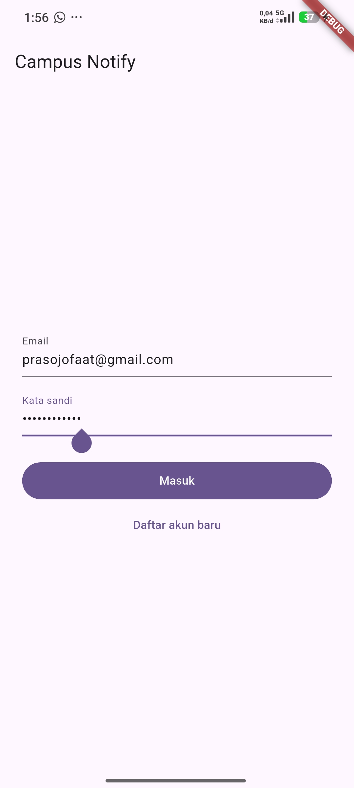
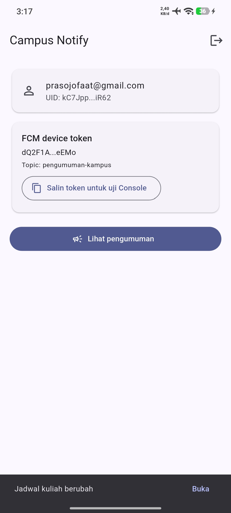
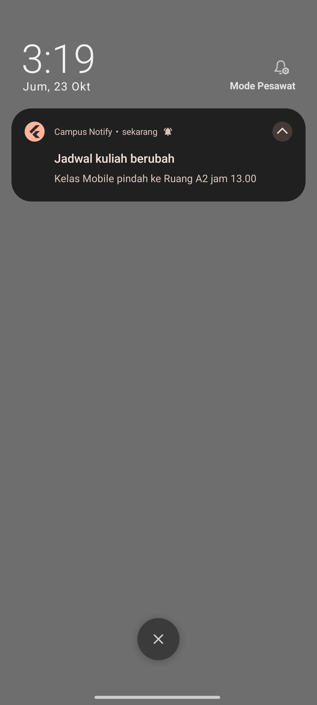
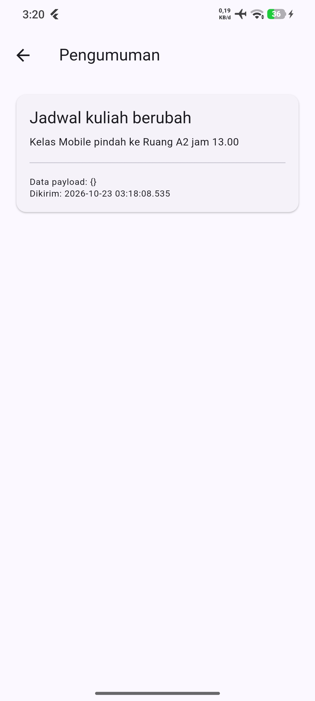

# Minggu 6 - Authentication Security FCM

**Nama:** Faatihurrizki Prasojo

**NIM:** 244107020142

## Tujuan 
- Menjelaskan alur autentikasi (Firebase Auth / JWT / OAuth / Google Login) dan perbedaan ID token vs access token vs refresh token;
- Menyimpan token secara aman dengan secure storage serta menerapkan token refresh otomatis;
- Menjelaskan arsitektur FCM: app server, Firebase, dan perangkat;
- Meminta notification permission dan mengelola token lifecycle (`getToken`, `onTokenRefresh`);
- Membedakan notification payload vs data payload serta perilakunya pada state foreground, background, dan terminated;
- Menangani klik notifikasi (deep link dengan GoRouter) dan topic messaging;
- Menerapkan prinsip keamanan dasar aplikasi mobile (tidak menyimpan secret di kode, tidak log token).

## Setup (sekali saja)

```bash
flutter pub add firebase_core firebase_auth firebase_messaging flutter_riverpod go_router flutter_secure_storage
dart pub global activate flutterfire_cli
flutterfire configure --project=week6-mobile-course
```

`flutterfire configure` menimpa `lib/firebase_options.dart` (sekarang masih placeholder)
dan membuat `android/app/google-services.json`.

Di Firebase Console: Authentication > Sign-in method > aktifkan **Email/Password**.

## Menjalankan dan menguji

```bash
flutter analyze
flutter test
flutter run
```

## Dokumentasi Praktikum
| Autentikasi & FCM Token | Home | Notifikasi | Isi Pengumuman |
| :---: | :---: |:---: | :---: |
|  |  |  |   |
|Tampilan antarmuka login dan halaman utama setelah autentikasi berhasil, menampilkan FCM token unik perangkat untuk pengujian push notification. | Tampilan awal setelah berhasil login, ada token untuk mengubungkan antara firebase dengan aplikasi mobile yang sedang dijalankan  | Banner notifikasi sistem muncul pada status bar ketika aplikasi diminimalkan (ditekan tombol Home) saat pesan FCM diterima. | Halaman detail pengumuman (/pengumuman/:id) yang langsung terbuka setelah banner notifikasi diklik, menampilkan ID pengumuman, judul, dan isi pesan notifikasi lengkap. |


## AI Challenge 

## PushService untuk Campus Notification App

Berikut implementasi `lib/messaging/push_service.dart`. Asumsi: `flutter_local_notifications` versi 20 ke atas (parameter `initialize()` dan `show()` bersifat named) dan `firebase_messaging` terbaru.

#### Kode

```dart
import 'dart:async';

import 'package:firebase_core/firebase_core.dart';
import 'package:firebase_messaging/firebase_messaging.dart';
import 'package:flutter/foundation.dart';
import 'package:flutter_local_notifications/flutter_local_notifications.dart';
import 'package:flutter_riverpod/flutter_riverpod.dart';
import 'package:go_router/go_router.dart';

import '../auth/token_store.dart';
import '../firebase_options.dart';
import '../router/app_router.dart';

// Penanda:
//   [NO-CONTEXT]  jalan di luar widget tree / isolate lain, dilarang pakai BuildContext
//   [ANDROID 13+] khusus Android API 33 ke atas
//   [iOS]         khusus iOS

/// [NO-CONTEXT] Handler background: jalan di isolate terpisah.
/// Wajib fungsi top-level + @pragma agar tidak dibuang tree-shaking saat release.
@pragma('vm:entry-point')
Future<void> firebaseMessagingBackgroundHandler(RemoteMessage message) async {
  await Firebase.initializeApp(options: DefaultFirebaseOptions.currentPlatform);
  debugPrint('[FCM background] id=${message.messageId}');
}

/// Fungsi murni (mudah di-unit-test). Hanya menerima rute di whitelist.
String routeFromMessage(RemoteMessage message) {
  final raw = message.data['route'];
  if (raw is String && AppRoutes.deepLinkable.contains(raw)) return raw;
  return AppRoutes.announcement;
}

/// Kontrak pengiriman token ke backend (POST /devices).
typedef DeviceRegistrar = Future<void> Function(String token);

Future<void> _logOnlyRegistrar(String token) async {
  debugPrint('[FCM] POST /devices, token=${maskToken(token)}');
}

final pushServiceProvider = Provider<PushService>((ref) {
  final service = PushService(
    ref.read(tokenStoreProvider),
    registerDevice: _logOnlyRegistrar,
  );
  ref.onDispose(service.dispose);
  return service;
});

class PushService {
  PushService(this._tokenStore, {required DeviceRegistrar registerDevice})
      : _registerDevice = registerDevice;

  static const campusTopic = 'pengumuman-kampus';

  static const _channel = AndroidNotificationChannel(
    'campus_announcements',
    'Pengumuman Kampus',
    description: 'Notifikasi pengumuman dari kampus',
    importance: Importance.high,
  );

  final TokenStore _tokenStore;
  final DeviceRegistrar _registerDevice;
  final FlutterLocalNotificationsPlugin _local = FlutterLocalNotificationsPlugin();
  final List<StreamSubscription<dynamic>> _subs = [];
  GoRouter? _router;
  bool _started = false;
  bool _localReady = false;

  final ValueNotifier<String?> fcmToken = ValueNotifier(null);
  final ValueNotifier<RemoteMessage?> lastMessage = ValueNotifier(null);

  Future<void> start(GoRouter router) async {
    if (_started) return;
    _started = true;
    _router = router;
    final fm = FirebaseMessaging.instance;

    // [ANDROID 13+] memunculkan dialog POST_NOTIFICATIONS (API 33+).
    // [iOS] memunculkan dialog izin alert/badge/sound.
    final settings = await fm.requestPermission();
    if (settings.authorizationStatus == AuthorizationStatus.denied) {
      _started = false;
      return;
    }

    await _initLocalNotifications();

    // Listener dipasang dulu, supaya tidak ada pesan yang terlewat.
    _subs
      ..add(FirebaseMessaging.onMessage.listen(_onForeground))
      ..add(FirebaseMessaging.onMessageOpenedApp.listen(_open))
      ..add(fm.onTokenRefresh.listen(_handleToken));

    try {
      await _waitForApnsTokenIfIos(fm);
      final token = await fm.getToken();
      if (token != null) await _handleToken(token);
    } catch (e) {
      debugPrint('[FCM] getToken gagal: $e');
    }

    await subscribeTopic();

    // State terminated.
    final initial = await fm.getInitialMessage();
    if (initial != null) _open(initial);
  }

  Future<void> stop() async {
    for (final s in _subs) {
      await s.cancel();
    }
    _subs.clear();
    await unsubscribeTopic();
    lastMessage.value = null;
    _started = false;
  }

  Future<void> subscribeTopic() async {
    if (kIsWeb) return;
    try {
      await FirebaseMessaging.instance.subscribeToTopic(campusTopic);
    } catch (e) {
      debugPrint('[FCM] subscribe gagal: $e');
    }
  }

  Future<void> unsubscribeTopic() async {
    if (kIsWeb) return;
    try {
      await FirebaseMessaging.instance.unsubscribeFromTopic(campusTopic);
    } catch (e) {
      debugPrint('[FCM] unsubscribe gagal: $e');
    }
  }

  // [iOS] getToken butuh APNs token yang datang asinkron.
  Future<void> _waitForApnsTokenIfIos(FirebaseMessaging fm) async {
    if (kIsWeb || defaultTargetPlatform != TargetPlatform.iOS) return;
    for (var i = 0; i < 5; i++) {
      if (await fm.getAPNSToken() != null) return;
      await Future<void>.delayed(const Duration(seconds: 1));
    }
  }

  Future<void> _handleToken(String token) async {
    fcmToken.value = token;
    await _tokenStore.saveFcmToken(token);
    try {
      await _registerDevice(token);
    } catch (e) {
      debugPrint('[FCM] kirim token gagal: $e');
    }
  }

  Future<void> _initLocalNotifications() async {
    if (kIsWeb || _localReady) return;

    const initSettings = InitializationSettings(
      android: AndroidInitializationSettings('@mipmap/ic_launcher'),
      // [iOS] izin sudah diminta lewat FCM, jangan diminta dua kali.
      iOS: DarwinInitializationSettings(
        requestAlertPermission: false,
        requestBadgePermission: false,
        requestSoundPermission: false,
      ),
    );

    await _local.initialize(
      settings: initSettings,
      onDidReceiveNotificationResponse: _onLocalTap,
    );

    // [ANDROID 13+] channel wajib ada sebelum notifikasi tampil (API 26+).
    await _local
        .resolvePlatformSpecificImplementation<
            AndroidFlutterLocalNotificationsPlugin>()
        ?.createNotificationChannel(_channel);

    _localReady = true;
  }

  /// [NO-CONTEXT] State foreground: tampilkan local notification manual.
  Future<void> _onForeground(RemoteMessage message) async {
    lastMessage.value = message;
    if (kIsWeb || !_localReady) return;

    final title = message.notification?.title ??
        message.data['title']?.toString() ??
        'Pesan baru';
    final body =
        message.notification?.body ?? message.data['body']?.toString() ?? '';

    await _local.show(
      id: (message.messageId ?? DateTime.now().toIso8601String()).hashCode &
          0x7FFFFFFF,
      title: title,
      body: body,
      notificationDetails: NotificationDetails(
        android: AndroidNotificationDetails(
          _channel.id,
          _channel.name,
          channelDescription: _channel.description,
          importance: Importance.high,
          priority: Priority.high,
        ),
        iOS: const DarwinNotificationDetails(),
      ),
      payload: routeFromMessage(message),
    );
  }

  /// [NO-CONTEXT] Tap pada local notification.
  void _onLocalTap(NotificationResponse response) {
    final payload = response.payload;
    if (payload != null && AppRoutes.deepLinkable.contains(payload)) {
      _router?.go(payload);
    }
  }

  /// [NO-CONTEXT] Background (onMessageOpenedApp) dan terminated (getInitialMessage).
  void _open(RemoteMessage message) {
    lastMessage.value = message;
    _router?.go(routeFromMessage(message));
  }

  void dispose() {
    for (final s in _subs) {
      s.cancel();
    }
    fcmToken.dispose();
    lastMessage.dispose();
  }
}
```

#### Konfigurasi pendukung

```bash
flutter pub add firebase_core firebase_messaging flutter_local_notifications flutter_secure_storage go_router flutter_riverpod
```

`android/app/src/main/AndroidManifest.xml`:

```xml
<uses-permission android:name="android.permission.POST_NOTIFICATIONS"/>
```

`android/app/build.gradle.kts` (dibutuhkan flutter_local_notifications):

```kotlin
compileOptions { isCoreLibraryDesugaringEnabled = true }
dependencies { coreLibraryDesugaring("com.android.tools:desugar_jdk_libs:2.1.4") }
```

`main.dart` harus mendaftarkan handler sebelum `runApp`:

```dart
FirebaseMessaging.onBackgroundMessage(firebaseMessagingBackgroundHandler);
```

#### Perbedaan Android 13+ vs iOS

| Aspek | Android 13+ | iOS |
|---|---|---|
| Izin | `POST_NOTIFICATIONS` di manifest + dialog runtime | Dialog alert/badge/sound, tidak perlu manifest |
| Token | `getToken` langsung bisa | Harus menunggu APNs token dulu |
| Channel | Wajib dibuat (API 26+) | Tidak ada konsep channel |
| Foreground | Tidak ada banner otomatis, buat local notification | Sama, banner tidak muncul otomatis |
| Setup tambahan | Core library desugaring | APNs key dan capability Push Notifications |

### Bagian yang dilarang mengakses BuildContext

1. `firebaseMessagingBackgroundHandler`: berjalan di isolate lain, tidak ada widget tree.
2. `_onForeground`, `_onLocalTap`, dan `_open`: dipanggil dari stream dan callback plugin, bukan dari `build()`. Navigasi memakai instance `GoRouter` yang diberikan lewat `start(router)`.

#### Catatan

- `POST /devices` dibuat sebagai callback `DeviceRegistrar` karena belum ada backend. Ganti `_logOnlyRegistrar` dengan pemanggilan HTTP saat backend siap.
- Rute dari `data.route` dicocokkan dengan whitelist, jadi payload tidak bisa mengarahkan app ke rute sembarang.
- Token tidak pernah di-log utuh, hanya lewat `maskToken`.

## Refleksi

#### 1. Mengapa refresh token tidak boleh disimpan di SharedPreferences? Apa risikonya bila bocor?

SharedPreferences menyimpan data sebagai file biasa (XML di Android, plist di iOS) tanpa enkripsi. File itu bisa dibaca lewat perangkat yang di-root, backup yang tidak dikunci (`allowBackup`), atau malware dengan akses ke penyimpanan app. `flutter_secure_storage` memakai Keystore (Android) dan Keychain (iOS), jadi isinya terenkripsi dan kuncinya dijaga sistem.

Risiko kalau bocor: refresh token berumur panjang dan bisa menukar access token baru terus-menerus. Penyerang bisa masuk sebagai korban tanpa password dan melewati 2FA, sampai sesi dicabut di server. Access token yang bocor jauh lebih aman karena umurnya pendek.

#### 2. Apa yang rusak bila `onTokenRefresh` diabaikan selama satu semester?

Token FCM bisa berganti, misalnya saat app di-install ulang, data dihapus, atau perangkat dipulihkan. Kalau token baru tidak dikirim ke backend, backend tetap memakai token lama. Dampaknya:
- Pesan personal (ke token) tidak sampai ke mahasiswa itu, tanpa error apa pun di sisi app.
- Backend menumpuk token mati dan tidak tahu mana yang valid.
- Mahasiswa mengira tidak ada pengumuman, padahal pesannya terkirim ke token yang sudah tidak berlaku.

#### 3. Kapan memakai topik dan kapan memakai token perangkat?

| | Topik | Token perangkat |
|---|---|---|
| Dipakai untuk | Broadcast ke banyak orang sekaligus | Pesan ke satu perangkat/orang |
| Contoh pesan kampus | "Jadwal kuliah Mobile pindah ke Ruang A2 jam 13.00" (topik `pengumuman-kampus`); "Kampus libur karena cuaca ekstrem" | "Nilai UTS Mobile kamu sudah terbit"; "Tagihan UKT jatuh tempo besok"; "Pengajuan cuti kamu disetujui" |
| Alasan | Backend tidak perlu menyimpan daftar token | Isinya khusus satu orang, tidak boleh dilihat orang lain |

#### 4. Bagian mana dari draf AI yang ditolak atau diperbaiki, dan mengapa?

- **Banner foreground dengan SnackBar → diganti `flutter_local_notifications`.** SnackBar hanya tampil di dalam app, padahal checklist mensyaratkan notifikasi sistem. Setelah diganti, banner muncul di bar notifikasi saat app terbuka.
- **`data.route` dipakai langsung → diberi whitelist.** Payload FCM berasal dari luar app, jadi hanya `/home` dan `/announcement` yang diterima. Selain itu diarahkan ke `/announcement`.
- **`getToken` dan `onTokenRefresh` ditandai deprecated → tidak dimigrasi.** Pengganti `onRegistered` memancarkan FID, bukan FCM token, dan efeknya ke uji dari Console belum terbukti.  
- **`POST /devices` → baru berupa callback, belum request nyata.** Belum ada backend, jadi token hanya dicatat dalam log (di-mask).
- **Dio interceptor dengan refresh-on-401 → tidak dibuat.** Sesi dikelola Firebase Auth lewat `idTokenChanges()`.
- **Tes bawaan `widget_test.dart` → dihapus.** Tes itu untuk aplikasi counter dan otomatis gagal setelah `main.dart` diganti.