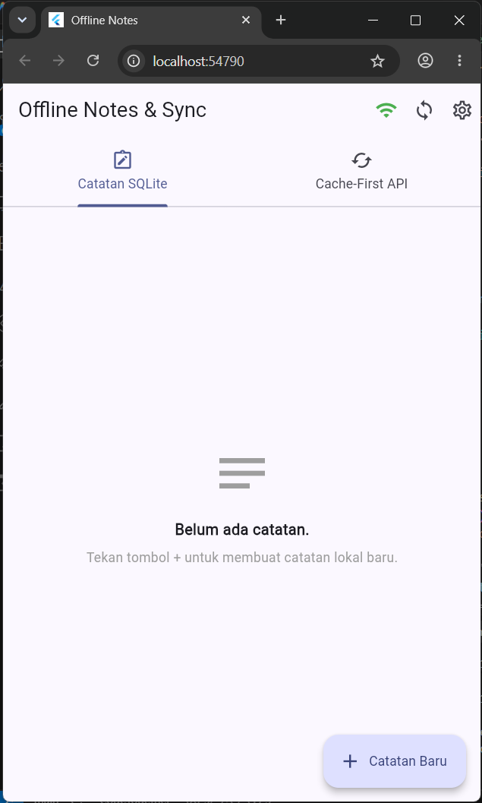
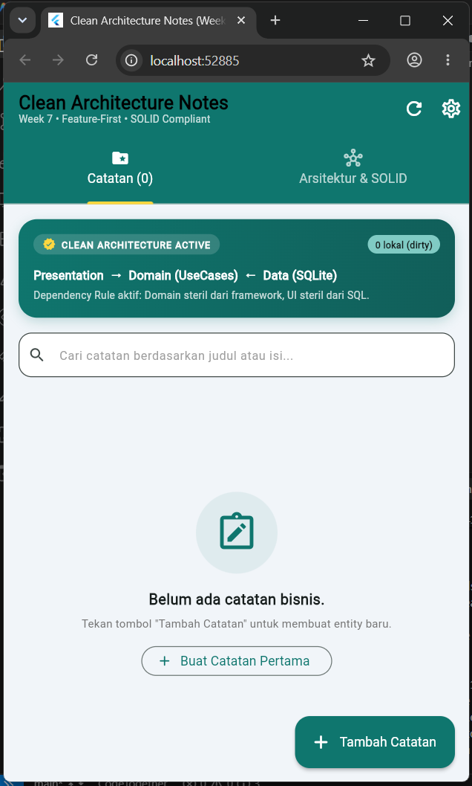
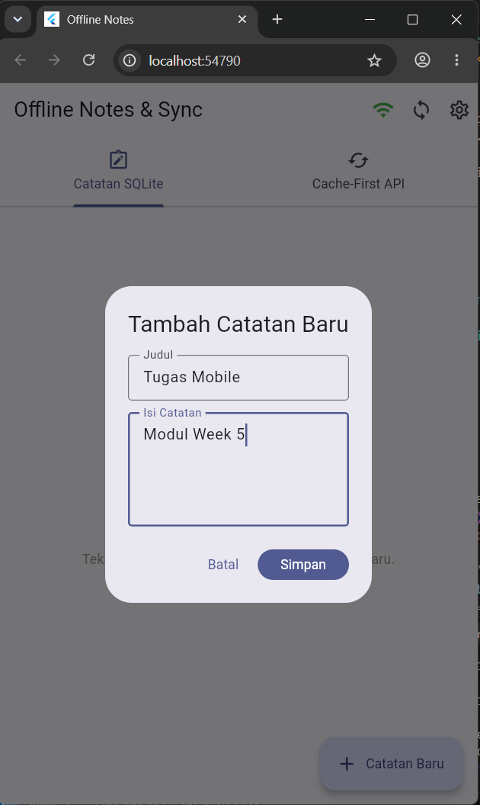
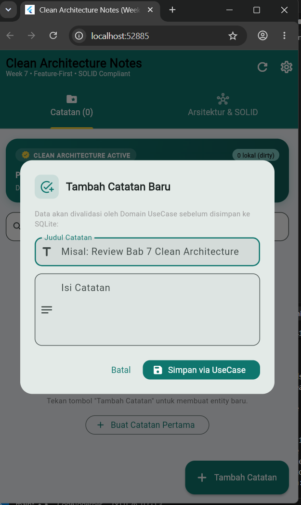
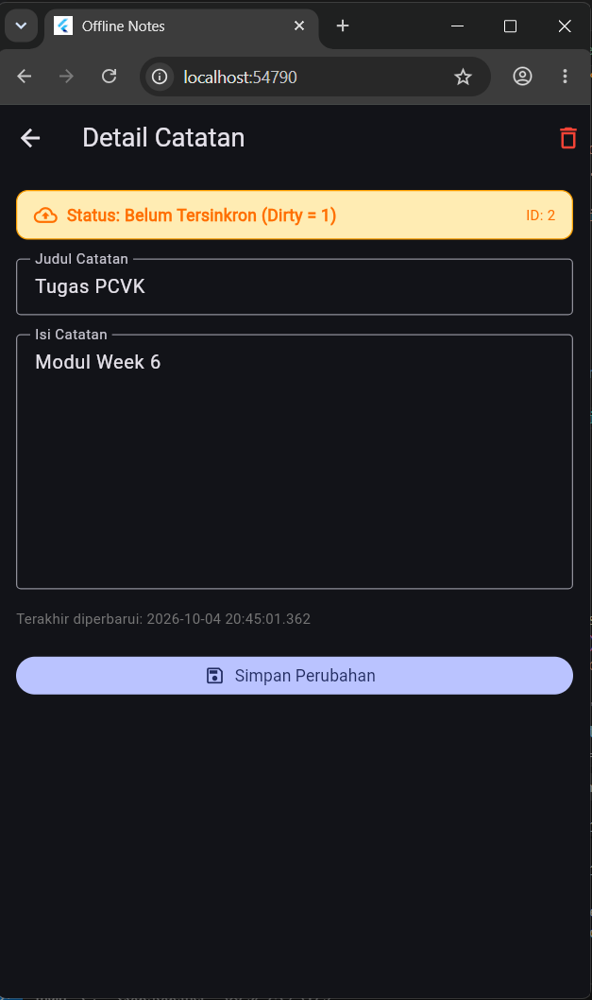
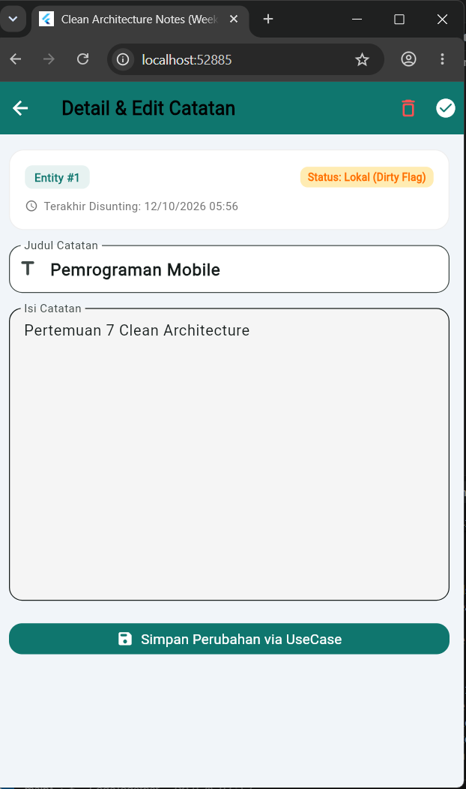
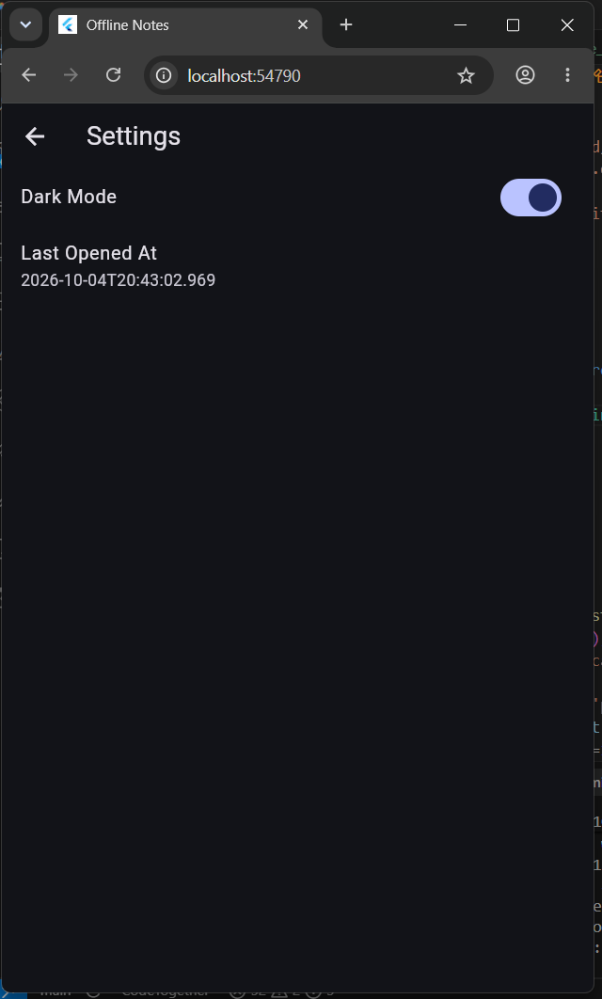
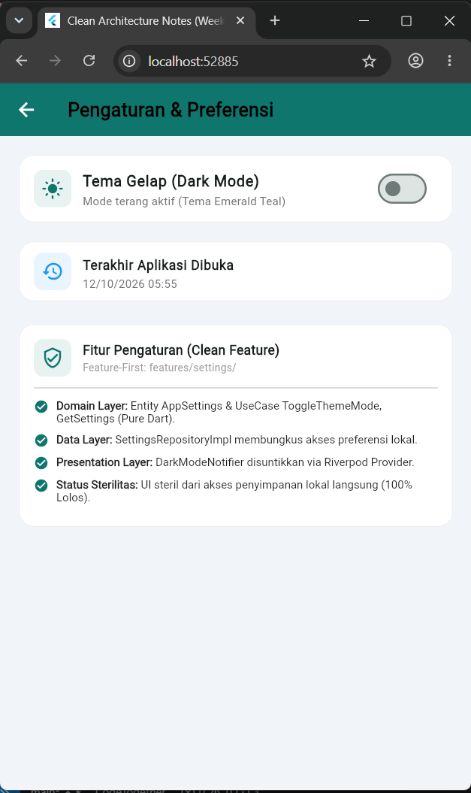
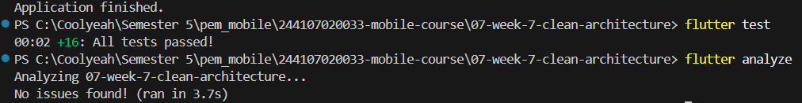

# Week 7 — Clean Architecture

Proyek Praktikum Week 7: Penerapan konsep **Clean Architecture (Feature-First)** pada pengembangan aplikasi Flutter (`clean_notes_app`).

---

## 1. Tujuan Pembelajaran

Setelah mengikuti dan menyelesaikan praktikum ini, mahasiswa diharapkan dapat:

- Memahami konsep **SOLID** dan *Separation of Concerns* serta penerapannya melalui kode Flutter.
- Mengetahui perbedaan pendekatan arsitektur **feature-first** dan **layer-first**, termasuk kelebihan serta kekurangan masing-masing.
- Membangun tiga lapisan utama, yaitu **Presentation**, **Domain**, dan **Data**, sesuai aturan dependensi (*Dependency Rule*) yang mengharuskan arah dependensi menuju bagian inti.
- Memahami perbedaan fungsi **Entity** sebagai objek bisnis dan **Model** sebagai representasi data, serta kegunaan **Repository Interface**, **Use Case**, dan **Dependency Injection (DI)**.
- Melakukan perubahan struktur aplikasi penyimpanan lokal (*offline-first*) menjadi arsitektur Clean Architecture dengan pendekatan *feature-first*.
- Melakukan pengujian pada domain dan *use case* secara terpisah menggunakan **Fake Repository**, tanpa membutuhkan koneksi database maupun jaringan secara langsung.
- Memastikan setiap layer telah sesuai dengan aturan arsitektur melalui *static analysis* dan pemeriksaan pola menggunakan *ripgrep*.

---

## 2. Arsitektur dan Diagram Layer

Pada aplikasi ini, Clean Architecture diterapkan menggunakan pola **Feature-First**, yaitu setiap fitur mempunyai susunan tiga layer secara mandiri. Setiap lapisan memiliki tanggung jawab masing-masing dan mengikuti ketentuan arah dependensi.

```text
┌─────────────────────────────────────────────────────────────┐
│                     PRESENTATION LAYER                      │
│     (Pages, Widgets, Riverpod Providers, Notifiers)        │
└──────────────────────────────┬──────────────────────────────┘
                               │ bergantung pada (imports)
                               ▼
┌─────────────────────────────────────────────────────────────┐
│                        DOMAIN LAYER                         │
│       (Entities, Repository Interfaces, Use Cases, Failures)│
│                ★ THE CORE — PURE DART ★                    │
└──────────────────────────────▲──────────────────────────────┘
                               │ diimplementasikan oleh
                               │ (implements & maps to entity)
┌──────────────────────────────┴──────────────────────────────┐
│                         DATA LAYER                          │
│    (Models + toMap/fromMap, Repository Impl, SQLite Datasource)│
└─────────────────────────────────────────────────────────────┘
```

### Aturan Utama (The Golden Dependency Rule)

1. **Domain sebagai Inti Logika Bisnis (The Core)**: Domain ditulis menggunakan Dart murni dan tidak memiliki ketergantungan terhadap framework Flutter UI, SQLite, SharedPreferences, Dio, maupun Firebase.

2. **Arah Dependensi ke Dalam**: Presentation hanya berkomunikasi dengan abstraksi yang tersedia pada Domain, sedangkan Data bertugas menyediakan implementasi dari kontrak yang telah ditentukan Domain.

3. **Perbedaan Entity dan Model**: Entity yang berada di `domain/entities` berfungsi sebagai representasi objek bisnis tanpa proses serialisasi. Sementara itu, Model pada `data/models` bertanggung jawab menangani konversi data melalui `toMap()`, `fromMap()`, dan `.toEntity()`.

4. **Dependency Injection**: Pengelolaan serta penyediaan dependensi dilakukan secara terpusat menggunakan Riverpod Provider (`notes_providers.dart` dan `settings_providers.dart`). Dengan demikian, widget tidak perlu membuat objek repository secara langsung menggunakan `new Repository()`.

---

## 3. Struktur Proyek (Feature-First)

```text
07-week-7-clean-architecture/
├── lib/
│   ├── main.dart                                   # Entry point + ProviderScope + tema
│   ├── routes.dart                                 # GoRouter + parsing rute murni
│   ├── core/                                       # Inti lintas fitur (Murni Dart)
│   │   ├── failures.dart                           # Failure domain (Local, Network, Validation)
│   │   └── format.dart                             # Fungsi murni formatting & route parser
│   └── features/
│       ├── notes/                                  # Fitur Utama: Manajemen Catatan
│       │   ├── domain/                             # DOMAIN LAYER (Pure Dart)
│       │   │   ├── entities/
│       │   │   │   └── note.dart                   # Entity bisnis Note
│       │   │   ├── repositories/
│       │   │   │   └── note_repository.dart        # Kontrak abstrak interface
│       │   │   └── usecases/
│       │   │       ├── get_notes.dart              # UseCase: Ambil daftar catatan
│       │   │       ├── add_note.dart               # UseCase: Tambah catatan + validasi
│       │   │       ├── update_note.dart            # UseCase: Perbarui catatan
│       │   │       └── delete_note.dart            # UseCase: Hapus catatan
│       │   ├── data/                               # DATA LAYER
│       │   │   ├── datasources/
│       │   │   │   └── notes_database.dart         # SQLite opener (Web/Mobile)
│       │   │   ├── models/
│       │   │   │   └── note_model.dart             # Model Note (toMap/fromMap/toEntity)
│       │   │   └── repositories/
│       │   │       └── note_repository_impl.dart  # Implementasi kontrak NoteRepository
│       │   └── presentation/                       # PRESENTATION LAYER
│       │       ├── providers/
│       │       │   └── notes_providers.dart        # Wiring DI Riverpod & state UI
│       │       ├── pages/
│       │       │   ├── notes_page.dart             # Halaman utama (List, empty, retry)
│       │       │   └── note_detail_page.dart       # Halaman detail & edit catatan
│       │       └── widgets/
│       │           └── note_tile.dart              # Widget baris catatan + badge lokal
│       └── settings/                               # Fitur Kedua: Pengaturan & Tema
│           ├── domain/                             # DOMAIN LAYER
│           │   ├── entities/
│           │   │   └── app_settings.dart           # Entity AppSettings
│           │   ├── repositories/
│           │   │   └── settings_repository.dart    # Kontrak SettingsRepository
│           │   └── usecases/
│           │       ├── get_settings.dart           # UseCase: Ambil preferensi
│           │       └── toggle_theme_mode.dart      # UseCase: Ganti tema gelap/terang
│           ├── data/
│           │   └── repositories/
│           │       └── settings_repository_impl.dart # Implementasi SharedPreferences
│           └── presentation/                       # PRESENTATION LAYER
│               ├── providers/
│               │   └── settings_providers.dart     # Provider DI & DarkModeNotifier
│               └── pages/
│                   └── settings_page.dart          # UI preferensi tema & riwayat buka
├── test/
│   ├── add_note_test.dart                          # Pengujian validasi bisnis AddNote
│   ├── format_test.dart                            # Pengujian fungsi murni format & parse
│   ├── get_notes_test.dart                         # Pengujian GetNotes dengan Fake Repo
│   ├── note_test.dart                              # Pengujian NoteModel & DI Riverpod
│   ├── settings_test.dart                           # Pengujian domain Settings & toggle
│   └── widget_test.dart                            # Placeholder widget test
├── docs/
│   └── AI_CHALLENGE.md                             # Dokumentasi evaluasi AI & trade-offs
├── screenshots/                                    # Bukti tangkapan layar pengujian
└── README.md                                       # Laporan praktikum lengkap
```

---

## 4. Teknologi yang Digunakan

| Komponen | Paket / Teknologi | Peran dalam Aplikasi |
|---|---|---|
| Framework | Flutter SDK 3.x / Dart 3.x | Digunakan untuk membangun antarmuka dan menjalankan logika aplikasi. |
| State Management & DI | `flutter_riverpod ^3.4.3` | Mengatur state aplikasi sekaligus menangani Dependency Injection. |
| Routing Declarative | `go_router ^18.0.2` | Mengelola perpindahan halaman menggunakan sistem navigasi berbasis path. |
| Relational Database | `sqflite ^2.4.4` | Menyimpan data catatan secara permanen pada tabel lokal `notes`. |
| Web Database Engine | `sqflite_common_ffi_web ^1.2.0` | Mendukung penggunaan SQLite melalui browser. |
| Key-Value Storage | `shared_preferences ^2.5.5` | Menyimpan pengaturan tema dan riwayat penggunaan aplikasi. |
| Testing Toolkit | `flutter_test`, `sqflite_common_ffi` | Membantu menjalankan pengujian unit pada use case dan model. |

---

## 5. Praktikum 1: Audit Layer dan Tiga Pelanggaran Klasik

### 1. Hasil Audit dan Pemetaan File Lama ke Layer

Sebelum proses refactoring dilakukan, struktur aplikasi sebelumnya diperiksa terlebih dahulu. Tujuannya adalah menemukan bagian kode yang masih mencampurkan beberapa tanggung jawab (*Separation of Concerns*).

| File Lama | Layer Lama | Permasalahan | Tindakan Refactoring |
|---|---|---|---|
| `pages/notes_page.dart` | Presentation | Masih terdapat proses database di dalam dialog, pemformatan tanggal dilakukan langsung pada UI, serta pemuatan ulang data secara manual. | Dipindahkan ke `features/notes/presentation/pages/notes_page.dart`. Seluruh proses operasi diarahkan melalui UseCase. |
| `pages/note_detail_page.dart` | Presentation | Halaman masih mengakses method repository secara langsung dan belum mempunyai pengelolaan state yang terstruktur. | Dipindahkan ke `features/notes/presentation/pages/note_detail_page.dart` dengan memanfaatkan `noteDetailProvider(id)`. |
| `data/local/note.dart` | Data / Domain | Data bisnis dan fungsi serialisasi database (`toMap`, `fromMap`) masih digabung dalam satu kelas. | Dipisahkan menjadi Entity `Note` pada domain dan `NoteModel` pada data layer. |
| `data/local/db.dart` | Data | Pengelolaan database masih berada pada folder `data/` secara umum. | Dipindahkan ke datasource `features/notes/data/datasources/notes_database.dart`. |
| `data/repositories/note_repository.dart` | Data | Kontrak repository dan implementasinya masih menjadi satu, sehingga belum tersedia interface abstrak yang mudah di-mock. | Dipisahkan menjadi interface `NoteRepository` di domain dan `NoteRepositoryImpl` di data. |
| `data/prefs.dart` | Data | Notifier masih menggunakan penyimpanan preferensi secara langsung tanpa melalui abstraksi domain. | Diubah menjadi interface `SettingsRepository` pada domain dan implementasi `SettingsRepositoryImpl` pada data. |

---

## 6. Pemeriksaan Sterilitas Layer dan Hasil Pengujian

### 1. Hasil Tiga Pemeriksaan Sterilitas (Ripgrep Checks)

Mengacu pada ketentuan modul praktikum, dilakukan tiga jenis pemeriksaan untuk memastikan penerapan **Dependency Inversion Principle** dan **The Golden Dependency Rule** telah sesuai.

Ketiga pemeriksaan tersebut ditargetkan menghasilkan **NOL HASIL (0 Matches / Steril Total)**.

#### Pemeriksaan 1: Presentation Tidak Mengakses Data Mentah dan Database

Pengujian pertama bertujuan memastikan bahwa halaman maupun widget tidak melakukan akses langsung terhadap koneksi database, HTTP client, penyimpanan lokal, ataupun proses decoding JSON.

- **Perintah yang dijalankan:**

  ```bash
  rg "Dio\(|openDatabase|getDatabasesPath|FlutterSecureStorage|SharedPreferences\.getInstance|jsonDecode" lib/features/*/presentation lib/pages
  ```

- **Hasil dari Terminal:**

  ```text
  0 matches found (Steril Total - Lolos)
  ```

- **Penjelasan:** Seluruh proses yang berhubungan dengan SQLite dan penyimpanan preferensi telah ditempatkan pada Data layer, melalui `NoteRepositoryImpl` dan `SettingsRepositoryImpl`. Sementara itu, komponen pada Presentation hanya bertugas mengambil informasi state melalui Riverpod Provider serta menjalankan operasi menggunakan UseCase.

---

#### Pemeriksaan 2: Domain Tidak Bergantung pada Framework atau Package Eksternal

Pemeriksaan kedua dilakukan untuk mengetahui apakah seluruh logika bisnis pada folder `domain` dan `core` sudah menggunakan Dart murni (*Pure Dart*), tanpa mengimpor framework Flutter UI, SQLite, Dio, maupun Firebase.

- **Perintah yang dijalankan:**

  ```bash
  rg "import 'package:flutter|import 'package:dio|import 'package:sqflite|import 'package:firebase" lib/features/*/domain lib/core
  ```

- **Hasil dari Terminal:**

  ```text
  0 matches found (Steril Total - Lolos)
  ```

- **Penjelasan:** Seluruh bagian domain, termasuk `entities`, `repositories`, dan `usecases`, serta folder core yang berisi `failures.dart` dan `format.dart`, tidak memiliki keterikatan dengan package eksternal. Kondisi tersebut membuat aturan bisnis bisa diuji secara mandiri melalui unit test tanpa menjalankan Flutter maupun emulator database.

---

#### Pemeriksaan 3: Tidak Ada Pembuatan Repository Secara Manual pada UI (DI Bocor)

Pemeriksaan terakhir digunakan untuk memastikan bahwa komponen Presentation tidak membuat objek repository sendiri menggunakan `new Repository()`. Seluruh dependensi harus diperoleh melalui mekanisme Dependency Injection yang telah disediakan.

- **Perintah yang dijalankan:**

  ```bash
  rg "Repository\(|Dio\(BaseOptions" lib/features/*/presentation/pages lib/features/*/presentation/widgets
  ```

- **Hasil dari Terminal:**

  ```text
  0 matches found (Steril Total - Lolos)
  ```

- **Penjelasan:** Penyediaan seluruh dependensi sudah dikelola melalui Riverpod Provider yang terdapat pada `notes_providers.dart` dan `settings_providers.dart`. Dengan begitu, widget hanya menggunakan `ref.watch()` atau `ref.read()` untuk mendapatkan dependensi yang diperlukan.

---

### 2. Pemeriksaan Static Analysis (`flutter analyze`)

Proses *static analysis* dilakukan untuk memeriksa kualitas kode, termasuk kemungkinan kesalahan tipe data, masalah linting, dan variabel yang tidak digunakan.

```bash
flutter analyze
```

**Hasil Eksekusi Terminal:**

```text
Analyzing 07-week-7-clean-architecture...
No issues found! (ran in 3.0s)
```

Hasil tersebut menunjukkan bahwa proses analisis berhasil diselesaikan tanpa menemukan masalah pada kode aplikasi.

---

### 3. Pelaksanaan Unit Test (`flutter test`)

Pengujian unit dilakukan untuk memverifikasi fungsi Entity, Model, Use Case dengan Fake Repository, helper format, serta integrasi Riverpod Provider.

```bash
flutter test
```

**Hasil Eksekusi Terminal:**

```text
00:00 +0: C:/.../test/add_note_test.dart: AddNote UseCase Test (Validation & Domain Logic) Gagal validasi jika judul kosong atau hanya spasi
00:00 +1: C:/.../test/add_note_test.dart: AddNote UseCase Test (Validation & Domain Logic) Berhasil menyimpan catatan dengan judul valid dan melakukan trim
00:00 +2: C:/.../test/format_test.dart: Core Pure Format & Route Parser Tests formatDisplayDate memformat DateTime ke format DD/MM/YYYY HH:mm
00:00 +3: C:/.../test/format_test.dart: Core Pure Format & Route Parser Tests parseRouteId mengurai string angka dan menangani null/kosong/invalid
00:00 +4: C:/.../test/format_test.dart: Core Pure Format & Route Parser Tests formatNoteSnippet memotong teks panjang dan membersihkan newline
00:00 +5: C:/.../test/get_notes_test.dart: GetNotes UseCase Test (Pure Domain) GetNotes meneruskan daftar dari repository
00:00 +6: C:/.../test/get_notes_test.dart: GetNotes UseCase Test (Pure Domain) GetNotes meneruskan failure tanpa melempar exception
00:00 +7: C:/.../test/note_test.dart: NoteModel Data Layer Tests fromMap aman terhadap field yang hilang dan mengonversi ke default
00:00 +8: C:/.../test/note_test.dart: NoteModel Data Layer Tests flag dirty bertahan pada serialisasi model
00:00 +9: C:/.../test/note_test.dart: NoteModel Data Layer Tests toEntity menghasilkan domain entity murni tanpa method serialisasi
00:00 +10: C:/.../test/note_test.dart: Presentation Provider DI Wiring Tests provider sukses dengan repository palsu disuntikkan
00:00 +11: C:/.../test/note_test.dart: Presentation Provider DI Wiring Tests provider error menangkap Failure dan melempar Exception ramah UI
00:00 +12: C:/.../test/settings_test.dart: Settings Feature Domain Tests GetSettings mengembalikan entity AppSettings murni
00:00 +13: C:/.../test/settings_test.dart: Settings Feature Domain Tests ToggleThemeMode membalik nilai state dark mode
00:00 +14: C:/.../test/settings_test.dart: Settings Feature Domain Tests ToggleThemeMode mempertahankan mode lama saat repository gagal
00:00 +15: C:/.../test/widget_test.dart: placeholder
00:00 +16: All tests passed!
```

Berdasarkan hasil tersebut, seluruh **16 unit test berhasil dijalankan tanpa kegagalan (100% lulus)**.

---

## 7. Bukti Tangkapan Layar (Screenshots)

Bagian ini memperlihatkan perbandingan tampilan aplikasi sebelum dan sesudah proses refactoring. Perbandingan dilakukan antara **Before (Week 5: Struktur Monolitik / Layer-First)** dan **After (Week 7: Clean Architecture Feature-First)**, sekaligus menampilkan hasil pengujian aplikasi.

| Fitur / Halaman | Before (Week 5: Layer-First / Monolith) | After (Week 7: Clean Architecture Feature-First) | Perubahan yang Dilakukan |
| :---: | :---: | :---: | :--- |
| **1. Halaman Utama Catatan** |  |  | **Before:** Antarmuka masih menggunakan tampilan tab monolitik sederhana dan proses query database dilakukan langsung dari UI. <br><br> **After:** Tampilan diperbarui dengan desain Deep Teal yang dilengkapi Dashboard Status Clean Architecture, fitur pencarian catatan secara real-time, badge entitas domain, serta tab interaktif untuk melihat visualisasi tiga layer. Pengambilan data kini menggunakan `GetNotes` usecase melalui Riverpod `notesProvider`. |
| **2. Dialog Tambah Catatan** |  |  | **Before:** Proses penyimpanan catatan masih menjalankan query insert SQLite langsung dari dialog tanpa pemeriksaan aturan bisnis. <br><br> **After:** Penambahan catatan dilakukan melalui `AddNote` usecase. Domain layer menangani validasi input, seperti pemeriksaan judul kosong dan penghapusan spasi berlebih sebelum data diteruskan ke SQLite. Pengguna juga memperoleh pesan kesalahan yang lebih mudah dipahami. |
| **3. Detail dan Edit Catatan** |  |  | **Before:** Halaman pengeditan masih berupa form standar dan belum memisahkan model data dari entity bisnis. <br><br> **After:** Halaman dilengkapi kartu informasi entity yang menampilkan `Entity #ID`, `Pure Dart Entity`, status SQLite, dan timestamp. Proses perubahan catatan dilakukan melalui `UpdateNote` usecase. |
| **4. Pengaturan dan Preferensi** |  |  | **Before:** Pengaturan tema masih disimpan dengan memanggil `SharedPreferences.getInstance()` secara langsung dari state UI. <br><br> **After:** Pengaturan dipisahkan menjadi fitur tersendiri pada `features/settings` dengan susunan Clean Architecture yang terdiri dari `SettingsRepository`, `GetSettings`, dan `ToggleThemeMode`. Dengan demikian, UI tidak lagi mengakses penyimpanan secara langsung. |
| **5. Tampilan Dark Mode** |  |  | **Before:** Mode gelap masih menggunakan tampilan sederhana dengan kontras warna bawaan. <br><br> **After:** Tampilan diperbarui menggunakan kombinasi warna Deep Slate dan Emerald Teal agar terlihat lebih modern. Pengaturan tema juga sudah terhubung dengan `darkModeProvider` dan Material 3. |

### Bukti Hasil Pengujian Static Analysis dan Unit Test

| Jenis Pengujian | Bukti Tangkapan Layar | Hasil dan Keterangan |
| :---: | :---: | :--- |
| **Flutter Analyze & Flutter Test** |  | **Berhasil 100%:** Pemeriksaan `flutter analyze` tidak menemukan masalah (*No issues found!*). Selain itu, seluruh 16 pengujian yang mencakup usecase, model, format helper, dan provider berhasil dilewati (*All tests passed!*). |

---

## 8. Refleksi Praktikum

### 1. Mengapa interface repository sebaiknya berada di domain, bukan data? Apa dampaknya jika posisinya dibalik?

Penempatan interface repository di dalam domain merupakan bagian dari penerapan **Dependency Inversion Principle (DIP)** serta aturan dependensi pada Clean Architecture. Prinsip ini mengatur agar bagian yang memiliki tanggung jawab terhadap aturan bisnis tidak bergantung secara langsung pada bagian teknis yang menangani penyimpanan data.

- **Domain Menentukan Kontrak:** Domain bertugas menetapkan kebutuhan data yang diperlukan oleh aplikasi, misalnya melalui fungsi `fetchNotes()`. Domain hanya menentukan data apa yang dibutuhkan tanpa harus mengetahui proses pengambilannya.

- **Dampak Jika Penempatan Dibalik:** Apabila interface repository justru diletakkan di data layer, domain harus mengimpor bagian data untuk dapat menggunakan kontrak tersebut. Hal ini menyebabkan arah dependensi menjadi tidak sesuai dengan prinsip Clean Architecture. Selain itu, ketika teknologi penyimpanan diganti, misalnya SQLite beralih ke Firestore, perubahan pada data layer dapat memengaruhi domain. Akibatnya, domain kehilangan independensinya dan pengujian unit tidak lagi bisa dilakukan secara murni tanpa melibatkan package pihak ketiga.

### 2. Dalam kondisi apa Use Case diperlukan, dan kapan repository dapat langsung digunakan oleh notifier?

- **Use Case diperlukan apabila:**

  1. **Terdapat aturan bisnis atau validasi tertentu.** Contohnya pada `AddNote`, ketika sistem perlu memastikan judul catatan tidak kosong dan menghilangkan spasi yang tidak diperlukan sebelum data disimpan.

  2. **Melibatkan beberapa sumber data sekaligus.** Sebagai contoh, aplikasi harus mengambil data dari SQLite lokal kemudian mengoordinasikan proses sinkronisasi dengan REST API.

  3. **Membutuhkan pengujian logika bisnis secara terpisah.** Use Case memungkinkan setiap alur bisnis diuji secara independen tanpa harus melibatkan keseluruhan aplikasi.

- **Repository dapat langsung digunakan oleh Notifier apabila:**

  Operasi yang dijalankan hanya berupa proses sederhana (*simple pass-through*) tanpa memerlukan validasi maupun pengolahan data tambahan. Misalnya, mengambil catatan berdasarkan ID atau menghitung jumlah item. Pada kondisi seperti ini, penggunaan Use Case yang hanya berisi satu baris kode justru menambah struktur kode yang tidak terlalu diperlukan (*boilerplate*) tanpa memberikan manfaat teknis yang berarti.

### 3. Apa saja dampak over-engineering akibat penggunaan Use Case satu baris untuk setiap CRUD pada tim kecil? Kapan penerapannya layak dilakukan?

- **Dampak Over-Engineering pada Tim Kecil:**

  - **Jumlah Boilerplate Bertambah:** Struktur proyek menjadi semakin banyak file. Bahkan untuk satu operasi sederhana, pengembang dapat harus membuat atau mengubah beberapa bagian, seperti entity, model, interface, implementasi repository, use case, dan provider.
  
  - **Proses Pengembangan Menjadi Lebih Lambat:** Waktu pengerjaan lebih banyak digunakan untuk membuat kelas pembungkus dibandingkan mengembangkan fungsi utama aplikasi.

  - **Kompleksitas Pemahaman Meningkat:** Pengembang baru membutuhkan waktu lebih lama untuk memahami susunan file dan mengikuti alur proses dari satu komponen ke komponen lainnya.

- **Kapan Penerapannya Menjadi Seimbang dengan Biayanya?**

  - Pada aplikasi berskala enterprise yang mempunyai banyak modul serta melibatkan sejumlah pengembang dalam pengerjaan fitur secara bersamaan.
  
  - Ketika aturan bisnis cukup kompleks dan sering mengalami perubahan. Pemisahan Use Case dapat membantu mengurangi konflik saat proses *merge Git* serta membatasi dampak perubahan agar tidak menimbulkan bug pada bagian lain.

### 4. Rekomendasi AI apa yang tidak digunakan atau disederhanakan, dan apa alasannya?

Pada proses evaluasi AI Challenge, terdapat beberapa saran dari AI Coding Assistant yang tidak diterapkan sepenuhnya karena perlu disesuaikan dengan kebutuhan serta struktur proyek.

1. **Tidak Membuat Use Case Terpisah untuk Semua Operasi Sederhana**

   AI sempat menyarankan pembuatan beberapa Use Case, seperti `CountDirtyNotes`, `GetNoteById`, dan `MarkAllSyncedNotes`. Saran tersebut tidak seluruhnya diterapkan karena fungsi-fungsi tersebut hanya meneruskan pemanggilan repository tanpa mengandung aturan bisnis tambahan. Oleh sebab itu, Notifier dapat langsung menggunakan abstraksi `NoteRepository`.

2. **Memindahkan Database Opener dari Folder Core**

   Pada awalnya, AI memberikan usulan untuk menempatkan fungsi pembuka database di `lib/core/db.dart`. Namun, pendekatan tersebut diubah dengan menempatkan file database pada `lib/features/notes/data/datasources/notes_database.dart`. Keputusan ini diambil karena core harus tetap bebas dari ketergantungan terhadap package database maupun framework eksternal agar pemeriksaan sterilitas dapat terpenuhi.

3. **Memperbaiki Pengelolaan Error Menggunakan Failure**

   Implementasi awal dari AI masih memungkinkan kesalahan database diteruskan ke UI dalam bentuk `Exception` mentah. Bagian tersebut kemudian diperbaiki dengan mengelompokkan jenis kesalahan ke dalam sealed class `Failure`, yaitu `LocalFailure`, `NetworkFailure`, dan `ValidationFailure`. Setiap kegagalan dapat ditampilkan menggunakan pesan berbahasa Indonesia yang lebih mudah dimengerti pengguna.

---

# Dokumentasi AI Challenge: Arsitektur dan Reorganisasi Clean Architecture

Dokumentasi ini berisi hasil peninjauan terhadap rekomendasi AI Coding Assistant selama proses perubahan struktur proyek Flutter menjadi **Feature-First Clean Architecture**. Pembahasan meliputi pertimbangan teknis, perbandingan *trade-off*, identifikasi over-engineering, serta alasan di balik keputusan akhir yang digunakan dalam proyek.

---

## 1. AI Prompt Challenge

Berikut merupakan prompt yang diberikan kepada AI Coding Assistant untuk membantu proses evaluasi dan perancangan ulang struktur proyek:

```text
Project Flutter saya: campus_notify / offline_notes.
Kondisi kini: folder lib/{data, providers, pages, messaging},
repository tercampur dengan implementasi, widget memanggil SQLite/SharedPreferences langsung.
Tugas:
1. Usulkan struktur feature-first Clean Architecture
   (presentation/domain/data) untuk fitur utama dan pendukung.
2. Untuk tiap file lama, sebutkan tujuan barunya (pindah/pecah/hapus).
3. Tandai bagian yang over-engineering bila diterapkan ke CRUD sederhana,
   dan kapan use case benar-benar dibutuhkan vs repository langsung.
4. Tunjukkan wiring DI dengan Riverpod (tanpa package DI tambahan).
Jelaskan trade-off setiap keputusan.
```

---

## 2. Pemetaan File Lama ke Struktur Baru (File Migration Matrix)

Tabel berikut memperlihatkan perubahan lokasi file dari struktur sebelumnya menuju susunan Clean Architecture yang baru, beserta pertimbangan teknis di balik setiap perubahan.

| File Lama | Layer Lama | Status dan Lokasi Baru | Pertimbangan Teknis |
|---|---|---|---|
| `data/local/note.dart` | Data (Tercampur) | **Dipisahkan** menjadi: <br>1. `features/notes/domain/entities/note.dart` <br>2. `features/notes/data/models/note_model.dart` | Entity pada domain hanya menyimpan informasi bisnis menggunakan Dart murni dan tidak menangani serialisasi seperti `toMap` atau `fromMap`. Proses serialisasi menjadi tanggung jawab model pada data layer. |
| `data/local/db.dart` | Data | **Dipindahkan** ke `features/notes/data/datasources/notes_database.dart` | Proses inisialisasi SQLite termasuk bagian teknis pengelolaan data sehingga harus berada di data layer, bukan pada core atau domain. |
| `data/repositories/note_repository.dart` | Data (Kontrak tercampur) | **Dipisahkan** menjadi: <br>1. `features/notes/domain/repositories/note_repository.dart` (Interface) <br>2. `features/notes/data/repositories/note_repository_impl.dart` (Implementasi) | Pemisahan dilakukan untuk menerapkan *Dependency Inversion Principle (DIP)*, yaitu kontrak repository menjadi tanggung jawab domain, sedangkan proses implementasinya berada di data layer. |
| `data/prefs.dart` | Data | **Dipisahkan** menjadi: <br>1. `features/settings/domain/repositories/settings_repository.dart` <br>2.`features/settings/data/repositories/settings_repository_impl.dart` | Penggunaan SharedPreferences diisolasi melalui repository implementasi. Dengan demikian, presentation tidak perlu mengakses `SharedPreferences.getInstance()` secara langsung. |
| `pages/notes_page.dart` | Presentation | **Dipindahkan dan Direfaktor** ke `features/notes/presentation/pages/notes_page.dart` | Halaman dibersihkan dari query database, pengelolaan data mentah, dan proses pembuatan repository secara langsung. Operasi data selanjutnya dijalankan melalui Riverpod Provider dan UseCase. |
| `pages/note_detail_page.dart` | Presentation | **Dipindahkan dan Direfaktor** ke `features/notes/presentation/pages/note_detail_page.dart` | Informasi detail catatan diperoleh melalui `noteDetailProvider(id)`, sedangkan proses penyimpanannya dilakukan menggunakan `updateNoteProvider`. |
| `pages/settings_page.dart` | Presentation | **Dipindahkan dan Direfaktor** ke `features/settings/presentation/pages/settings_page.dart` | Halaman pengaturan kini memanfaatkan `darkModeProvider` dan `settingsInfoProvider` tanpa mengakses penyimpanan secara langsung. |
| `widgets/note_tile.dart` | Presentation | **Dipindahkan** ke `features/notes/presentation/widgets/note_tile.dart` | Proses pemformatan tanggal dipisahkan ke fungsi pada `lib/core/format.dart` agar tidak membebani komponen UI. |

---

## 3. Checklist Verifikasi AI (AI Verification Checklist)

Seluruh saran yang diberikan oleh AI Coding Assistant diperiksa kembali untuk memastikan kesesuaiannya dengan kebutuhan aplikasi dan prinsip Clean Architecture.

| Item Checklist | Standar Pemeriksaan | Hasil Evaluasi dan Keputusan |
|---|---|---|
| **Pemisahan Interface dan Implementasi** | Interface harus ditempatkan di `domain`, sedangkan implementasinya berada di `data`. | **Diterapkan**. Interface `note_repository.dart` diletakkan pada `domain/repositories`, sementara `note_repository_impl.dart` berada di `data/repositories`. |
| **Sterilitas Domain** | Folder `domain` tidak boleh mengimpor framework atau package seperti `flutter`, `sqflite`, `dio`, dan `firebase`. | **Diterapkan dan Terbukti**. Hasil pemeriksaan `grep_search` pada `lib/features/*/domain` dan `lib/core` menunjukkan **0 hasil**, sehingga kedua bagian tersebut dinyatakan steril. |
| **Pemisahan Entity** | Entity tidak diperbolehkan memiliki method serialisasi seperti `toMap`, `fromMap`, atau `toJson`. | **Diterapkan**. Kelas `Note` dan `AppSettings` hanya memuat field bisnis serta constructor murni. Seluruh proses pemetaan data ditangani oleh `NoteModel`. |
| **Wiring DI Riverpod** | Pengelolaan dependensi dilakukan melalui Provider dan UI tidak boleh membuat repository secara manual. | **Diterapkan**. Komponen `ConsumerWidget` menggunakan `ref.watch` atau `ref.read`, sedangkan repository diberikan melalui mekanisme dependency injection dengan fungsi `openDb`. |
| **Use Case untuk Setiap CRUD Satu Baris** | Menilai apakah seluruh operasi sederhana perlu mempunyai Use Case masing-masing. | **Disesuaikan Setelah Evaluasi**. AI sempat merekomendasikan Use Case terpisah untuk operasi kecil seperti `CountDirtyNotes`, `MarkAllSyncedNotes`, dan `GetNoteById`. Rekomendasi ini dinilai berlebihan karena termasuk *over-engineering*. |

---

## 4. Analisis Over-Engineering dan Kondisi Penggunaan Use Case

### Risiko Over-Engineering pada Tim Kecil atau Fitur Sederhana

Membuat Use Case tersendiri untuk setiap operasi CRUD yang hanya terdiri dari satu baris kode, seperti `CountDirtyNotes` yang sekadar menjalankan `return repo.countDirty();`, dapat menyebabkan struktur proyek menjadi terlalu kompleks.

Beberapa dampak yang mungkin muncul antara lain:

- **Jumlah File Semakin Banyak:** Pengembang harus membuka dan mengelola lebih banyak file hanya untuk menjalankan sebuah operasi sederhana.

- **Perubahan Kode Menjadi Lebih Panjang:** Ketika terdapat perubahan pada tipe data, pengembang bisa perlu menyesuaikan beberapa bagian sekaligus, mulai dari Entity, Repository Interface, Use Case, hingga Repository Implementation.

- **Kecepatan Pengembangan Berkurang:** Waktu pengerjaan fitur menjadi kurang efisien karena terlalu banyak proses yang harus dilakukan untuk operasi yang sebenarnya sederhana.

### Kapan Use Case Sebaiknya Digunakan?

1. **Ketika Terdapat Logika Bisnis dan Validasi**

   Use Case dibutuhkan jika suatu proses harus melewati aturan tertentu sebelum data diproses oleh repository.

   - Contoh: `AddNote` dan `UpdateNote` memeriksa agar judul tidak kosong menggunakan `ValidationFailure`, sekaligus membersihkan spasi yang tidak diperlukan (*trimming*) sebelum menyimpan data.

2. **Ketika Membutuhkan Koordinasi Beberapa Repository atau Data Source**

   Use Case dapat berfungsi sebagai pengatur alur ketika suatu proses melibatkan lebih dari satu sumber data.

   - Contoh: Aplikasi mengambil data dari SQLite lokal dan kemudian melakukan koordinasi dengan API jarak jauh untuk proses sinkronisasi.

3. **Ketika Memerlukan Pengujian Unit Secara Terisolasi**

   Dengan memisahkan logika bisnis ke dalam Use Case, pengujian dapat dilakukan menggunakan mock atau Fake Repository tanpa perlu menjalankan aplikasi Flutter maupun emulator database.

### Kapan Repository Dapat Langsung Digunakan oleh Notifier?

Untuk operasi yang hanya melakukan pengambilan data sederhana (*pass-through read*) tanpa proses validasi atau transformasi tambahan, Notifier maupun Provider dapat langsung menggunakan abstraksi `NoteRepository`.

Contohnya adalah mengambil informasi catatan berdasarkan ID atau menghitung jumlah data. Dalam kondisi tersebut, membuat Use Case satu baris hanya akan menambah kode yang tidak terlalu dibutuhkan.

---

## 5. Ringkasan Keputusan Teknis Final

Berdasarkan hasil evaluasi terhadap struktur proyek dan rekomendasi AI, beberapa keputusan teknis berikut digunakan sebagai dasar implementasi akhir:

1. **Pengorganisasian Feature-First**

   Seluruh kode dikelompokkan berdasarkan fitur yang tersedia, yaitu `features/notes` dan `features/settings`, bukan berdasarkan layer secara global. Pendekatan ini membuat setiap fitur lebih terpisah dan memudahkan pengelolaan perubahan tanpa terlalu memengaruhi fitur lainnya.

2. **Penggunaan Dart Records untuk Return Value**

   Pengembalian hasil operasi menggunakan record `({T? data, Failure? failure})` agar informasi keberhasilan maupun kegagalan dapat disampaikan secara lebih terstruktur. Pendekatan ini juga mengurangi risiko runtime exception yang tidak tertangani dan diteruskan langsung ke UI.

3. **Pemisahan Fungsi Murni**

   Proses pemformatan tanggal dan penguraian parameter rute dipindahkan ke `lib/core/format.dart`. Dengan cara ini, fungsi tersebut bisa diperiksa menggunakan unit test secara mandiri tanpa bergantung pada komponen antarmuka aplikasi.