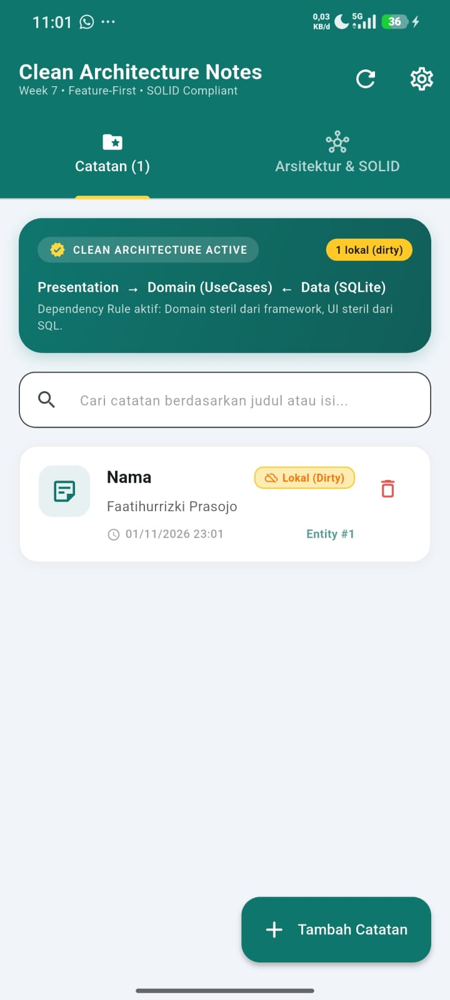
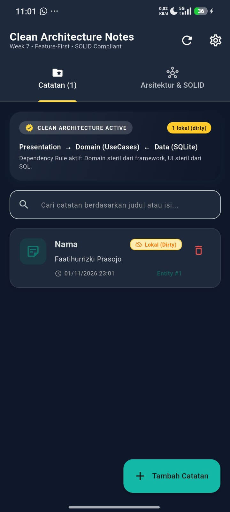
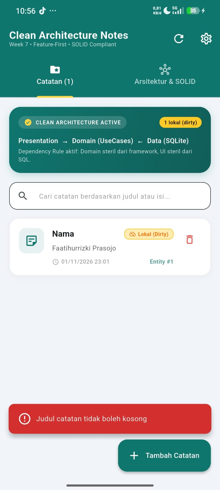
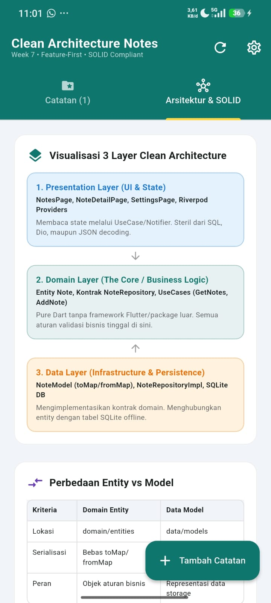
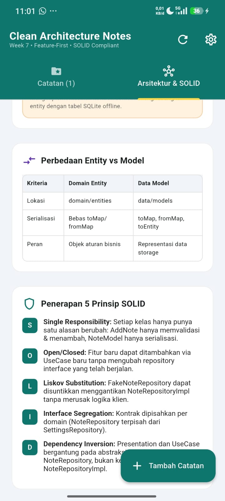

# Week 8 — Mid Project Review & Code Review

Proyek Praktikum Week 8: **Mid Project Review & Code Review** terhadap aplikasi hasil Week 7 (`Clean Architecture Notes`, Clean Architecture **Feature-First**). Praktikum ini tidak membuat aplikasi baru. Kode Week 7 disalin ke folder `Source_code/`, lalu diaudit, dirapikan oleh mesin (`dart format`, `flutter analyze`, `flutter test`), dan direview dengan bantuan AI. Folder Week 7 tidak diubah.

---

## 1. Tujuan Pembelajaran

- Menjelaskan **Git Flow** dan strategi branching (`main`, `develop`, `feature/*`, `fix/*`).
- Menulis commit dan Pull Request yang berkualitas dan mudah direview (format `tipe(scope): deskripsi`).
- Melakukan **peer code review** yang konstruktif dengan pola *observasi → dampak → usulan konkret*.
- Menjalankan *static analysis* dan formatter (`flutter analyze`, `dart format`) hingga bersih, lalu menjaganya lewat CI.
- Menilai kesiapan project tengah semester dan menindaklanjuti hasil review.
- Memverifikasi saran review dari AI sebelum diterapkan: temuan harus terbukti, dan temuan yang salah atau berlebihan ditolak dengan alasan.

---

## 2. Arsitektur dan Alur Kerja Review

Arsitektur aplikasi **tidak berubah** dari Week 7: tiga layer dengan arah dependensi menuju Domain.

```text
┌─────────────────────────────────────────────────────────────┐
│                     PRESENTATION LAYER                      │
│     (Pages, Widgets, Riverpod Providers, Notifiers)         │
└──────────────────────────────┬──────────────────────────────┘
                               │ bergantung pada (imports)
                               ▼
┌─────────────────────────────────────────────────────────────┐
│                        DOMAIN LAYER                         │
│       (Entities, Repository Interfaces, Use Cases, Failures)│
│                ★ THE CORE — PURE DART ★                    │
└──────────────────────────────▲──────────────────────────────┘
                               │ diimplementasikan oleh
                               │ (implements & maps to entity)
┌──────────────────────────────┴──────────────────────────────┐
│                         DATA LAYER                          │
│    (Models + toMap/fromMap, Repository Impl, SQLite Datasource)│
└─────────────────────────────────────────────────────────────┘
```

Yang baru di Week 8 adalah **alur kerja kolaborasi** di sekitar kode tersebut:

```text
issue  ->  branch (feature/* atau fix/*, dari develop)
       ->  commit kecil (tipe(scope): deskripsi)
       ->  PR ke develop (masalah -> solusi -> cara uji -> screenshot)
       ->  CI otomatis: dart format + flutter analyze + flutter test
       ->  review sejawat (Approve / Request changes)
       ->  merge (squash bila commit perantara berantakan) -> issue tertutup
```

### Aturan Utama

1. **Satu branch, satu tujuan.** `main` selalu bisa dirilis dan tidak disentuh langsung. `develop` menjadi target semua PR. `feature/*` dan `fix/*` berumur pendek.
2. **Satu commit, satu perubahan logis** yang bisa direview dan di-revert.
3. **Mesin dulu, manusia kemudian.** PR yang belum lolos format, analyze, dan test tidak layak diminta review.
4. **Keputusan akhir tetap milik penulis.** AI hanya reviewer awal; setiap temuannya harus dibuktikan sebelum diterapkan.

---

## 3. Struktur Proyek

```text
08_week_8_mid_project_review_code_review/
├── README.md                                       # Laporan praktikum (file ini)
├── screenshot/                                     # Bukti tangkapan layar aplikasi
│   ├── light_mode.jpeg
│   ├── dark_mode.jpeg
│   ├── tidak_boleh_ada_judul_kosong.jpeg
│   ├── clean_architecture_notes.jpeg
│   └── 5_prinsip_solid.jpeg
└── Source_code/
    ├── docs/                                       # Dokumentasi review
    │   ├── review-checklist.md                     # Audit Git, commit, temuan, kesiapan
    │   ├── ai-review-output.md                     # Output review AI (5 temuan + usulan kode)
    │   └── ai-review-vs-keputusan.md               # Usulan AI vs keputusan final
    ├── lib/
    │   ├── main.dart                               # Entry point + ProviderScope + tema
    │   ├── routes.dart                             # GoRouter yang dipakai main.dart
    │   ├── core/                                   # Inti lintas fitur (Murni Dart)
    │   │   ├── failures.dart
    │   │   └── format.dart
    │   ├── features/
    │   │   ├── notes/                              # domain / data / presentation
    │   │   └── settings/                           # domain / data / presentation
    │   ├── auth/                                   # Sisa Week 6 (login, token store)
    │   ├── messaging/                              # Sisa Week 6 (FCM push service)
    │   ├── pages/                                  # Sisa Week 6 (home, announcement)
    │   └── router/app_router.dart                  # Sisa Week 6 (router auth + FCM)
    └── test/
        ├── add_note_test.dart
        ├── update_note_test.dart                   # BARU di Week 8
        ├── get_notes_test.dart
        ├── format_test.dart
        ├── note_test.dart
        ├── settings_test.dart
        ├── push_and_auth_test.dart
        └── widget_test.dart                        # Placeholder

../.github/workflows/ci.yml                         # CI (di root repository)
```

---

## 4. Teknologi yang Digunakan

| Komponen | Paket / Teknologi | Peran dalam Aplikasi |
|---|---|---|
| Framework | Flutter SDK 3.x / Dart 3.x | Antarmuka dan logika aplikasi. |
| State Management & DI | `flutter_riverpod ^3.4.3` | State aplikasi sekaligus Dependency Injection. |
| Routing | `go_router ^18.1.1` | Navigasi berbasis path. |
| Relational Database | `sqflite ^2.4.5`, `sqflite_common_ffi_web ^1.2.0` | Penyimpanan catatan lokal (mobile dan web). |
| Key-Value Storage | `shared_preferences ^2.5.6` | Pengaturan tema dan riwayat buka aplikasi. |
| Secure Storage | `flutter_secure_storage ^11.2.0` | Penyimpanan token (sisa Week 6). |
| Firebase | `firebase_core`, `firebase_auth`, `firebase_messaging` | Autentikasi dan push notification (sisa Week 6). |
| Testing & Lint | `flutter_test`, `flutter_lints ^6.0.0` | Unit test dan static analysis. |
| CI | GitHub Actions (`subosito/flutter-action`) | Menolak PR yang tidak lolos format, analyze, dan test. |

> Project ini **tidak memakai Dio**; tidak ada remote datasource. Review hanya mencakup SQLite dan Firebase.

---

## 5. Praktikum 1: Audit Riwayat Git dan Perbaikan Commit

### 1. Hasil Audit Repository

Perintah yang dijalankan di repository portfolio:

```bash
git log --oneline -15
git branch -a
git status
```

| Temuan | Detail |
|---|---|
| Commit langsung ke `main` | Semua commit dibuat di `main`. |
| Tidak ada `develop` | Satu-satunya branch adalah `main` (dan `origin/main`). |
| Pesan commit tidak jelas | `-`, `Update`, `feat : debugging`, serta `feat : week 6 - report completed` tiga kali berturut-turut. |
| Branch berumur panjang | Tidak ada, karena tidak ada branch lain. |
| File tak terlacak | `08_week_8_mid_project_review_code_review/` dan `.github/` (hasil kerja Week 8). |

### 2. Menulis Ulang Pesan Commit

| Sebelum | Sesudah | Alasan |
|---|---|---|
| `-` (`0159a20`) | `test(widget): perbaiki widget_test week 3 dan week 6` | Isi commit hanya mengubah dua file `widget_test.dart`. |
| `Update` (`8150a28`) | `docs(readme): perbarui README` | Perubahan hanya satu baris di `README.md`. |
| `feat : debugging` (`d4f5ea1`) | `feat(week7): tambah project clean architecture + README` dan `chore(week7): tambah konfigurasi Android/iOS` | Satu commit memuat project lengkap dan konfigurasi platform; sebaiknya dipecah per perubahan logis. |

---

## 6. Praktikum 2: Pemeriksaan Mesin dan Hasil Pengujian

### 1. Format (`dart format`)

```bash
dart format --set-exit-if-changed lib test
```

**Sebelum:** `Formatted 39 files (26 changed)`, artinya 26 dari 39 file belum rapi.
**Sesudah:** `Formatted 40 files (0 changed)`, exit code 0 (40 file karena `update_note_test.dart` ditambahkan).

> Di Windows, `dart format .` dari root project gagal (`PathNotFoundException`) karena path panjang di folder `build/`, sehingga dipakai `dart format lib test`. Perintah yang sama dipakai di CI.

### 2. Static Analysis (`flutter analyze`)

```bash
flutter analyze
```

Setelah format, muncul dua info `curly_braces_in_flow_control_structures` di `lib/auth/login_page.dart`. Keduanya diperbaiki dengan memberi kurung kurawal pada `if`.

**Hasil Eksekusi Terminal:**

```text
Analyzing Source_code...
No issues found!
```

### 3. Pelaksanaan Unit Test (`flutter test`)

```bash
flutter test
```

**Hasil Eksekusi Terminal:**

```text
00:00 +0: C:/.../test/add_note_test.dart: AddNote UseCase Test (Validation & Domain Logic) Gagal validasi jika judul kosong atau hanya spasi
00:00 +1: C:/.../test/add_note_test.dart: AddNote UseCase Test (Validation & Domain Logic) Berhasil menyimpan catatan dengan judul valid dan melakukan trim
00:00 +2: C:/.../test/format_test.dart: Core Pure Format & Route Parser Tests formatDisplayDate memformat DateTime ke format DD/MM/YYYY HH:mm
00:00 +3: C:/.../test/format_test.dart: Core Pure Format & Route Parser Tests parseRouteId mengurai string angka dan menangani null/kosong/invalid
00:00 +4: C:/.../test/format_test.dart: Core Pure Format & Route Parser Tests formatNoteSnippet memotong teks panjang dan membersihkan newline
00:00 +5: C:/.../test/get_notes_test.dart: GetNotes UseCase Test (Pure Domain) GetNotes meneruskan daftar dari repository
00:00 +6: C:/.../test/get_notes_test.dart: GetNotes UseCase Test (Pure Domain) GetNotes meneruskan failure tanpa melempar exception
00:01 +7: C:/.../test/note_test.dart: NoteModel Data Layer Tests fromMap aman terhadap field yang hilang dan mengonversi ke default
00:01 +8: C:/.../test/note_test.dart: NoteModel Data Layer Tests flag dirty bertahan pada serialisasi model
00:01 +9: C:/.../test/note_test.dart: NoteModel Data Layer Tests toEntity menghasilkan domain entity murni tanpa method serialisasi
00:01 +10: C:/.../test/note_test.dart: Presentation Provider DI Wiring Tests provider sukses dengan repository palsu disuntikkan
00:01 +11: C:/.../test/note_test.dart: Presentation Provider DI Wiring Tests provider error menangkap Failure dan melempar Exception ramah UI
00:09 +12: C:/.../test/settings_test.dart: Settings Feature Domain Tests GetSettings mengembalikan entity AppSettings murni
00:09 +13..+14: C:/.../test/push_and_auth_test.dart: routeFromMessage memakai data.route kalau ada di whitelist
00:09 +15: C:/.../test/settings_test.dart: Settings Feature Domain Tests ToggleThemeMode mempertahankan mode lama saat repository gagal
00:09 +16: C:/.../test/push_and_auth_test.dart: routeFromMessage fallback ke /announcement kalau data.route tidak ada
00:09 +17: C:/.../test/push_and_auth_test.dart: routeFromMessage menolak rute di luar whitelist
00:09 +18..+20: C:/.../test/push_and_auth_test.dart: maskToken (null/kosong, token pendek, token panjang)
00:09 +21..+22: C:/.../test/push_and_auth_test.dart: authErrorMessage (invalid-credential, kode tak dikenal)
00:09 +23: C:/.../test/update_note_test.dart: UpdateNote UseCase Gagal validasi jika judul kosong
00:09 +24: C:/.../test/update_note_test.dart: UpdateNote UseCase Berhasil memperbarui catatan dengan judul valid
00:09 +25: C:/.../test/widget_test.dart: placeholder
00:09 +26: All tests passed!
```

Seluruh **26 unit test berhasil (100% lulus)**, naik dari 24 test di Week 7. Dua test tambahan berasal dari `test/update_note_test.dart`, karena `UpdateNote` memvalidasi judul kosong tetapi sebelumnya belum teruji.

### 4. Pemeriksaan Sterilitas Layer

Tiga pemeriksaan Week 7 dijalankan ulang pada kode Week 8 (dengan `grep -rnE`, karena `rg` belum terpasang di mesin ini). Ditambah satu pemeriksaan baru untuk arah impor.

| # | Pemeriksaan | Target | Hasil |
|---|---|---|---|
| 1 | Presentation tidak mengakses data mentah (`Dio(`, `openDatabase`, `getDatabasesPath`, `FlutterSecureStorage`, `SharedPreferences.getInstance`, `jsonDecode`) | `lib/features/*/presentation`, `lib/pages` | **0 hasil** (lolos) |
| 2 | Domain dan core tidak mengimpor `flutter`, `dio`, `sqflite`, `firebase` | `lib/features/*/domain`, `lib/core` | **0 hasil** (lolos) |
| 3 | UI tidak membuat repository sendiri (`Repository(`, `Dio(BaseOptions`) | `presentation/pages`, `presentation/widgets` | **0 hasil** (lolos) |
| 4 | Presentation tidak mengimpor folder `data/` (`import '.*/data/`) | `lib/features/*/presentation` | **3 hasil** (tidak lolos) |

Pemeriksaan 4 menemukan tiga impor dari `providers/` ke data layer:

```text
lib/features/notes/presentation/providers/notes_providers.dart:3:import '../..//data/datasources/notes_database.dart';
lib/features/notes/presentation/providers/notes_providers.dart:4:import '../../data/repositories/note_repository_impl.dart';
lib/features/settings/presentation/providers/settings_providers.dart:3:import '../../data/repositories/settings_repository_impl.dart';
```

Pemeriksaan 1 sampai 3 di Week 7 lolos karena pola pencariannya tidak mencakup impor `data/`. Ini dicatat sebagai temuan arsitektur (lihat bagian 8, temuan #3).

---

## 7. Bukti Tangkapan Layar (Screenshots)

Aplikasi dijalankan dengan `flutter run` di perangkat Android. Tampilannya identik dengan akhir Week 7, yang menjadi syarat "definisi selesai" pada codelab.

| Fitur / Halaman | Bukti Tangkapan Layar | Keterangan |
| :---: | :---: | :--- |
| **1. Halaman Utama (Light Mode)** |  | Dashboard "Clean Architecture Active", pencarian, serta daftar catatan dengan badge `Lokal (Dirty)` dan `Entity #1`. Data diambil lewat `GetNotes` use case dan `notesProvider`. |
| **2. Halaman Utama (Dark Mode)** |  | Tema gelap Deep Slate dan Emerald Teal dari `darkModeProvider`. Fungsi halaman sama dengan light mode. |
| **3. Validasi Judul Kosong** |  | Menambah catatan dengan judul kosong ditolak oleh `AddNote` (`ValidationFailure`), dan pesan **"Judul catatan tidak boleh kosong"** tampil. Dialog ikut tertutup sehingga input yang sudah diketik hilang; ini terkait temuan review #2. |
| **4. Tab Arsitektur & SOLID** |  | Visualisasi tiga layer dan tabel perbedaan Entity vs Model di dalam aplikasi. |
| **5. Penerapan 5 Prinsip SOLID** |  | Penjelasan S, O, L, I, D beserta contoh pada kode (`AddNote`, `NoteModel`, `FakeNoteRepository`, `NoteRepository` vs `SettingsRepository`). |

Subjudul aplikasi masih tertulis **"Week 7"**. Teks itu belum diubah karena di luar lingkup review ini (dicatat di `docs/review-checklist.md`).

### Screenshot yang masih perlu ditambahkan

Bagian ini belum memiliki gambar, sehingga belum ada bukti visualnya:

- Hasil `git log --oneline -15`, `git branch -a`, dan `git status` (audit Git).
- Hasil `dart format`, `flutter analyze`, dan `flutter test` di terminal.
- Issue, PR, review sejawat, status *Merged*, dan CI hijau di GitHub.
- Prompt dan output mentah AI.

---

## 8. Review Kode dan Dokumentasi AI

Dokumentasi lengkap ada di `Source_code/docs/`: [`review-checklist.md`](Source_code/docs/review-checklist.md), [`ai-review-output.md`](Source_code/docs/ai-review-output.md), dan [`ai-review-vs-keputusan.md`](Source_code/docs/ai-review-vs-keputusan.md).

### 1. AI Prompt Challenge

```text
Review PR Flutter ini sebagai senior Flutter dev.
Konteks: feature-first Clean Architecture (presentation -> domain <- data),
Riverpod, GoRouter, SQLite + Dio.
Fokus: kebenaran, arsitektur, dan test. Abaikan style.
Berikan 5 temuan teratas + level (blocker/saran)
+ alasan + usulan potongan kode perbaikan.
```

### 2. Lima Temuan Teratas

| # | Level | Area | Temuan | Bukti verifikasi | Status |
|---|---|---|---|---|---|
| 1 | **Blocker** | Kebenaran / arsitektur | Auth dan FCM Week 6 tidak terhubung ke aplikasi yang berjalan. `main.dart` memakai `routes.dart`, tidak memanggil `Firebase.initializeApp`, dan `appRouterProvider` hanya terjangkau dari halaman Week 6. Ada dua `AppRoutes`. | `grep` pada `lib/`: `Firebase.initializeApp` hanya di `push_service.dart`; `PushService.start` hanya dipanggil dari `HomePage`. | Menunggu keputusan produk (apakah login wajib?), dikerjakan di PR terpisah. |
| 2 | Saran | Kebenaran | Dialog tambah catatan memanggil `Navigator.pop` sebelum cek `failure`, sehingga input hilang saat validasi gagal. Controller juga tidak di-`dispose`. | Terlihat di screenshot validasi judul kosong (dialog tertutup). | Belum diterapkan. |
| 3 | Saran | Arsitektur | Provider presentation mengimpor data layer, dan `countDirty` / `getNoteById` memanggil repository langsung tanpa use case. | Pemeriksaan sterilitas #4 (3 hasil). | Belum diterapkan. Impor perlu dibenahi; use case baru belum tentu perlu (lihat Refleksi 4). |
| 4 | Saran | Kebenaran | `updateNote` dan `deleteNote` melaporkan sukses untuk id yang tidak ada, karena jumlah baris terdampak diabaikan. | Test SQLite in-memory sementara: `UPDATE success=true`, `DELETE success=true` untuk id 999 (test sudah dihapus). | Belum diterapkan. |
| 5 | Saran | Test | `NoteRepositoryImpl`, `DeleteNote`, dan UI tidak teruji. `markAllSynced` tidak punya pemanggil, jadi flag `dirty` tidak pernah dibersihkan. | `grep NoteRepositoryImpl test` kosong; `widget_test.dart` placeholder. | Sebagian: test `UpdateNote` ditambahkan; sisanya belum. |

### 3. Checklist Verifikasi AI (AI Verification Checklist)

| Item Checklist | Standar Pemeriksaan | Hasil Evaluasi dan Keputusan |
|---|---|---|
| **Temuan benar-benar ada** | Dibuktikan dengan grep, test gagal, atau reproduksi manual. | **Terpenuhi.** Temuan #1 (grep), #2 (screenshot), #3 (grep), dan #4 (test SQLite in-memory) memiliki bukti. |
| **Tidak melanggar dependency rule** | Domain tidak boleh mengimpor Flutter, Dio, atau SQLite. | **Terpenuhi.** Usulan perbaikan tidak menambah impor ke domain. Pemeriksaan sterilitas #2 tetap 0 hasil. |
| **Bukan nitpick style** | Style ditangani formatter dan CI, bukan komentar review. | **Terpenuhi.** 26 file yang belum rapi dibereskan oleh `dart format` dan dijaga CI. |
| **Minimal 2 temuan terbukti** | Dibuktikan dengan bukti nyata. | **Terpenuhi.** Temuan #1 dan #4. |
| **Minimal 1 temuan ditolak** | Ditolak dengan alasan tertulis. | **Terpenuhi.** Lihat tabel di bawah. |

**Usulan AI yang ditolak:**

| Usulan AI | Keputusan | Alasan |
|---|---|---|
| Mengekstrak validasi judul `AddNote` dan `UpdateNote` ke fungsi bersama di `core/`. | **Ditolak** | Validasinya hanya satu kondisi di dua tempat. Abstraksi baru menambah file tanpa manfaat nyata. Ditinjau ulang bila ada use case ketiga. |

---

## 9. Perubahan dari Week 7

| File | Perubahan | Alasan |
|---|---|---|
| 26 file di `lib/` dan `test/` | Diformat dengan `dart format`. | Formatter menjadi aturan otomatis; CI menolak PR yang belum rapi. |
| `lib/auth/login_page.dart` | Dua `if` diberi kurung kurawal. | Lint `curly_braces_in_flow_control_structures` muncul setelah format. |
| `test/update_note_test.dart` | Ditambahkan (2 test). | `UpdateNote` belum memiliki test. |
| `.github/workflows/ci.yml` | Ditambahkan di root repository. | Menolak PR yang gagal format, analyze, atau test sebelum dibaca manusia. |
| `Source_code/docs/*.md` | Ditambahkan. | Bukti audit, review, dan keputusan. |

Nama package diganti dari `week_7_clean_architecture` menjadi `week_8_mid_project_review_code_review` pada `pubspec.yaml` dan import di `test/`. ID aplikasi Android masih milik Week 6, jadi instalasi aplikasi ini dapat menimpa aplikasi Week 6 di perangkat yang sama.

---

## 10. Status Kesiapan Tengah Semester

| Kriteria | Status |
|---|---|
| Aplikasi berjalan identik dengan akhir Week 7 | ✅ Terbukti lewat screenshot |
| `dart format` bersih | ✅ |
| `flutter analyze` bersih | ✅ `No issues found!` |
| `flutter test` hijau | ✅ 26 test |
| Struktur feature-first, sterilitas layer | ⚠️ Pemeriksaan 1 sampai 3 lolos; pemeriksaan 4 menemukan 3 impor `data/` dari providers |
| CI ditambahkan | ✅ File ada; belum pernah dijalankan di GitHub |
| README + screenshot + cara menjalankan | ✅ (screenshot terminal dan GitHub masih kurang) |
| Branch `develop`, issue, PR kecil, review sejawat, merge | ❌ Belum dikerjakan |
| Temuan review #1 sampai #5 ditindaklanjuti | ❌ Baru sebagian (#5: test `UpdateNote`) |

### Peta Issue / PR

| Temuan | Status |
|---|---|
| Dua router, login/FCM belum terhubung ke `main.dart` | Backlog (PR terpisah) |
| Dialog tambah catatan menutup saat validasi gagal | Backlog |
| Impor `data/` dari providers presentation | Backlog |
| `updateNote` / `deleteNote` sukses untuk id tidak ada | Backlog |
| `UpdateNote` belum teruji | ✅ Selesai |
| Pindahkan `auth`, `pages`, `messaging` ke `features/` | Backlog |

---

## 11. Cara Menjalankan

```bash
cd Source_code
flutter pub get
flutter run
```

Pemeriksaan mesin (sama dengan CI):

```bash
dart format --set-exit-if-changed lib test
flutter analyze
flutter test
```

---

## 12. Refleksi Praktikum

### 1. Apa beda LGTM buta dengan approve yang bertanggung jawab? Apa risikonya bagi tim?

LGTM buta berarti menyetujui PR tanpa mengambil branch, menjalankan aplikasi, atau menjalankan test. Approve yang bertanggung jawab berarti reviewer sudah checkout, menjalankan `flutter analyze` dan `flutter test`, mencoba fitur secara manual, dan memberi minimal beberapa temuan bermakna.

Contoh di Week 8: `flutter test` hijau pada 24 test Week 7, tetapi `NoteRepositoryImpl` tidak pernah teruji, sehingga bug `updateNote` / `deleteNote` yang melaporkan sukses untuk id tidak ada lolos. Hasil hijau tidak otomatis berarti aman. Risikonya, bug masuk ke `develop` dengan label "sudah direview", dan tim kehilangan kepercayaan pada proses review itu sendiri.

### 2. Kapan komentar wajib berstatus *request changes*, dan kapan cukup saran?

*Request changes* dipakai bila temuan membuat aplikasi salah, tidak aman, atau melanggar kontrak arsitektur. Di Week 8, temuan #1 (login dan FCM tidak terhubung ke `main.dart`) masuk kategori ini, karena fitur Week 6 praktis mati. Saran cukup bila perilaku aplikasi tetap benar dan perbaikannya bersifat peningkatan, misalnya test tambahan atau urutan impor.

### 3. Bagian mana dari review AI yang Anda tolak atau sederhanakan, dan mengapa?

- **Ditolak:** ekstraksi validasi judul ke fungsi bersama. Hanya satu kondisi di dua tempat, sehingga abstraksi baru hanya menambah file.
- **Disederhanakan:** usulan use case baru `GetNoteById` dan `CountDirtyNotes` untuk temuan #3. Di Week 7 operasi *pass-through* seperti ini sengaja langsung memakai repository agar tidak over-engineering. Yang perlu diperbaiki adalah arah impor (provider mengimpor `data/`), bukan jumlah use case. Keputusan akhir untuk temuan ini masih terbuka.
- **Tidak dilanjutkan:** prompt menyebut Dio, padahal project ini tidak memakainya. Review dibatasi pada SQLite dan Firebase.

### 4. Satu hal konkret yang diperbaiki setelah review, dan dampaknya

- Menambahkan test `UpdateNote`, sehingga validasi judul kosong pada alur edit sekarang terlindungi (24 menjadi 26 test).
- Menjalankan `dart format` dan memperbaiki dua lint kurung kurawal. Hasilnya `dart format`, `flutter analyze`, dan `flutter test` bersih, dan CI menjaganya agar debat soal format tidak muncul lagi di review.
