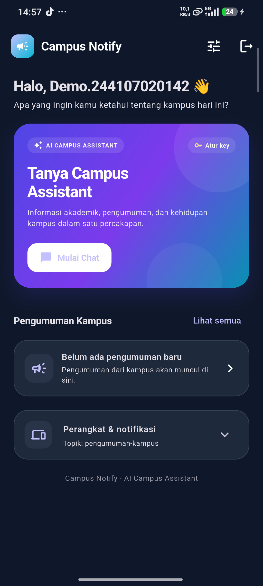
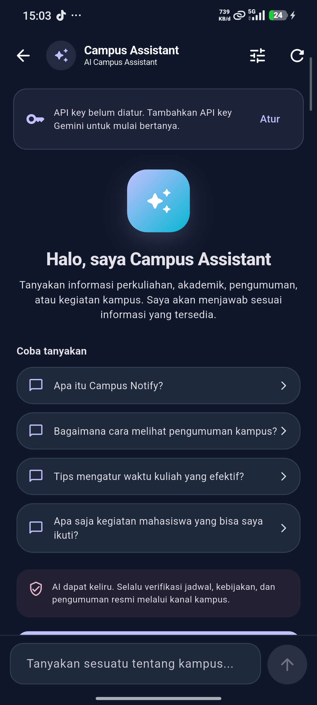
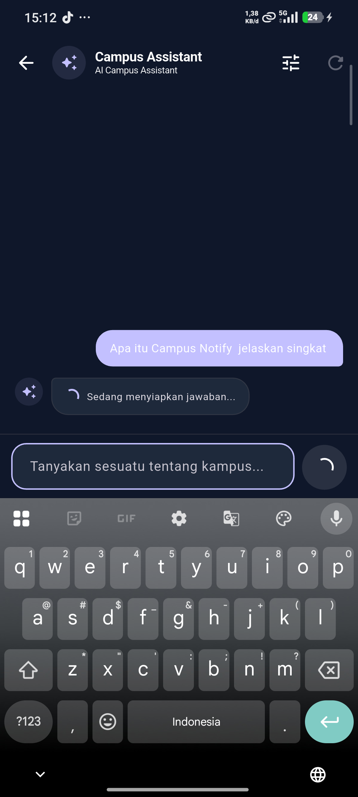
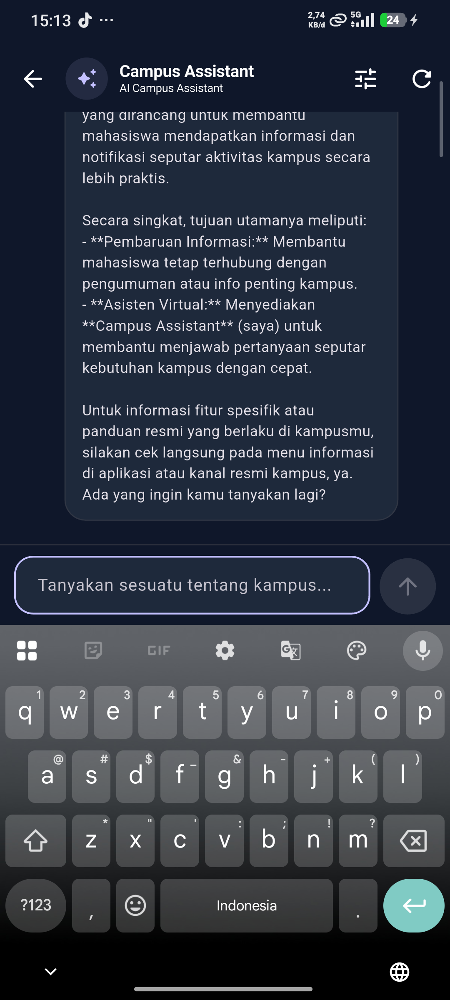
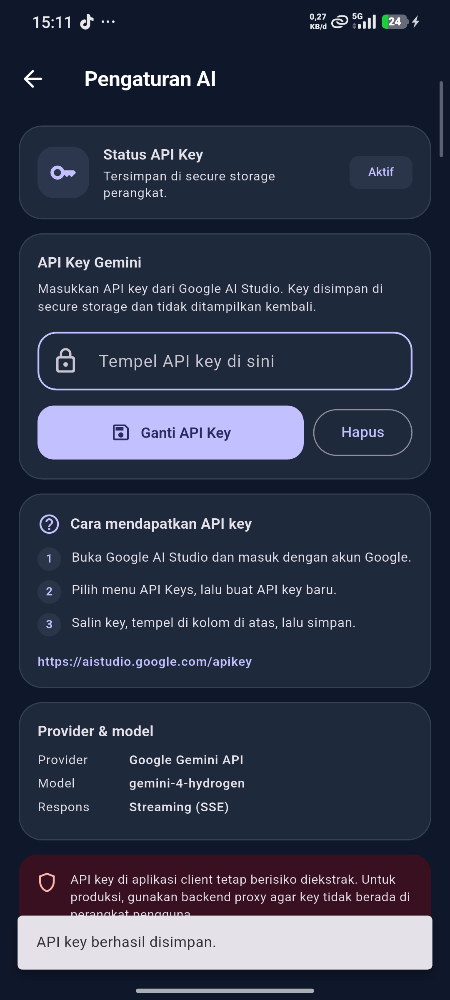
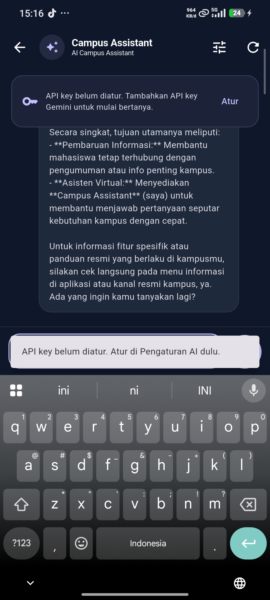

# Campus Notify — AI Campus Assistant

## 1. Deskripsi Aplikasi

Campus Notify adalah aplikasi Flutter untuk menerima pengumuman kampus lewat Firebase Cloud Messaging (FCM). Pada praktikum Minggu 10, aplikasi ini dikembangkan menjadi **AI Campus Assistant**: pengguna dapat bertanya seputar kehidupan kampus melalui halaman chat yang ditenagai Google Gemini, dengan jawaban yang tampil bertahap (streaming).

Aplikasi tetap mempertahankan fitur lama: login/daftar dengan Firebase Authentication, penerimaan FCM (foreground, background, dan terminated), serta daftar pengumuman.

## 2. Tujuan Praktikum

- Mengintegrasikan fitur AI (LLM API) ke aplikasi Flutter yang sudah ada tanpa membuat project baru.
- Memisahkan komunikasi API dari UI melalui service dan state management Riverpod.
- Menangani API key secara aman dengan secure storage dan tidak menuliskannya di source code.
- Menguji aplikasi pada perangkat Android fisik dan mendokumentasikan hasil yang benar-benar tercapai.

## 3. Fitur Aplikasi

**Fitur lama yang dipertahankan**
- Login dan daftar (Firebase Authentication), termasuk redirect saat belum/sudah login.
- Penerimaan notifikasi FCM dan deep link ke halaman pengumuman.
- Halaman pengumuman kampus, kini dengan tampilan baru.

**Fitur baru**
- **Dashboard yang diperbarui**: sapaan pengguna, kartu akses cepat ke AI Assistant, daftar pengumuman terbaru, dan panel perangkat/notifikasi.
- **AI Campus Assistant** (`/assistant`):
  - Welcome message dan empty state.
  - Contoh pertanyaan yang dapat dipilih.
  - Bubble pengguna dan bubble jawaban AI.
  - Indikator loading ("Sedang menyiapkan jawaban...") dan indikator streaming.
  - Validasi input: pesan kosong diabaikan, panjang maksimal 500 karakter, dan tombol kirim nonaktif saat request berjalan.
  - Keyboard tidak menutupi input.
- **Streaming response**: jawaban ditampilkan bertahap dari Server-Sent Events (SSE) Gemini.
- **Pengaturan AI** (`/ai-settings`): memasukkan, mengganti, dan menghapus API key; status konfigurasi; petunjuk mendapatkan key; info provider dan model.
- **Pengumuman sebagai konteks**: pengumuman FCM terakhir ikut dikirim sebagai konteks opsional. Aplikasi tidak mengklaim terhubung ke database kampus.

**Error handling dan fallback**
- API key belum diatur: banner di chat, dan pesan SnackBar jika pengguna mencoba mengirim. Teks yang sudah diketik tidak hilang.
- API key kosong atau terlalu pendek: validasi sebelum disimpan.
- Tidak ada internet, timeout, HTTP 300, 401/403, 429, 5xx, respons kosong, dan koneksi terputus saat streaming: dipetakan ke pesan ramah berbahasa Indonesia (tidak menampilkan exception mentah).
- Setiap pesan error memiliki tombol **Coba lagi** yang mengulang request terakhir tanpa menduplikasi bubble pengguna.
- Aplikasi tidak membuat jawaban palsu saat AI gagal.

## 4. Teknologi

| Teknologi | Versi (pubspec.yaml) | Fungsi |
|---|---|---|
| Flutter / Dart | SDK Dart ^3.13.5 (Flutter 3.47.7 saat pengujian) | Framework aplikasi |
| firebase_core | ^5.0.0 | Inisialisasi Firebase |
| firebase_auth | ^7.0.0 | Login dan daftar |
| firebase_messaging | ^17.0.0 | FCM (notifikasi) |
| flutter_riverpod | ^3.4.3 | State management |
| go_router | ^18.1.1 | Navigasi dan redirect auth |
| flutter_secure_storage | ^11.2.0 | Penyimpanan API key terenkripsi |
| http | ^1.5.0 | HTTP client untuk Gemini SSE |
| flutter_lints | ^6.0.0 | Aturan analyzer |

Provider AI: **Google Gemini API** (Interactions API), endpoint `https://generativelanguage.googleapis.com/v1beta/interactions?alt=sse`, model **`gemini-4-hydrogen`**. Endpoint dan nama model diverifikasi dari dokumentasi resmi Gemini (`ai.google.dev`) pada saat pengerjaan.

## 5. Arsitektur

Alur utama:

```
Flutter UI (pages/ai_chat_page.dart)
  → State management (ai/ai_chat_controller.dart, Riverpod Notifier)
    → AI service (ai/ai_service.dart, HTTP + parsing SSE)
      → Gemini API (Interactions API, streaming)
```

Pendukung:
- `ai/ai_config.dart`: satu-satunya tempat endpoint, model, system prompt, batas input, dan timeout.
- `ai/ai_key_store.dart`: membaca/menulis API key di `flutter_secure_storage`.
- `ai/ai_providers.dart`: provider Riverpod untuk key store, service, dan status key.
- `ai/ai_exception.dart`: pemetaan status HTTP dan error jaringan ke pesan pengguna.
- `router/app_router.dart`: rute `/home`, `/announcement`, `/assistant`, `/ai-settings`, dan redirect auth.
- `messaging/push_service.dart`: FCM, termasuk deep link ke halaman pengumuman.

Pemisahan tanggung jawab: UI tidak memanggil HTTP langsung. Controller mengelola state (pesan, loading, error, retry), sedangkan service hanya berurusan dengan request dan response.

## 6. Dokumentasi

| No. | Dokumentasi | Screenshot |
|---|---|---|
| 1 | Dashboard | {width="350"} |
| 2 | AI Assistant — welcome dan empty state (API key belum diatur) | {width="350"} |
| 3 | AI Assistant — pesan terkirim dan loading | {width="350"} |
| 4 | AI Assistant — jawaban dari Gemini (streaming) | {width="350"} |
| 5 | Pengaturan AI — API key tersimpan (key tidak ditampilkan) | {width="350"} |
| 6 | Error handling — kirim pesan tanpa API key | {width="350"} |

**Catatan:**
- Screenshot 05 diambil saat API key sudah tersimpan dan key tidak terlihat di layar.
- Screenshot 06 diambil setelah API key dihapus dari perangkat.

## 7. Konfigurasi API Key

1. Buka [Google AI Studio](https://aistudio.google.com/apikey) dan masuk dengan akun Google.
2. Buat API key baru dari menu API Keys.
3. Di aplikasi, buka **ikon pengaturan (tune)** di Dashboard atau AppBar chat, atau tombol **Atur key**.
4. Tempel key di kolom **API Key Gemini**, lalu tekan **Simpan API Key**.
5. Status berubah menjadi **Aktif**. Key disimpan di secure storage perangkat dan tidak ditampilkan kembali. Gunakan **Hapus** untuk menghapusnya.

Aturan keamanan yang diterapkan:
- Key tidak ditulis di source code, README, atau Git.
- Key tidak dicatat di log dan tidak ditampilkan di UI setelah disimpan.
- Test otomatis memakai `MockClient` dan fake key store, sehingga tidak mengirim request berbayar.

**Peringatan produksi:** API key yang berada di aplikasi client tetap berisiko diekstrak dari perangkat. Untuk produksi, gunakan backend proxy yang menyimpan key di server.

## 8. Cara Menjalankan Aplikasi

Prasyarat: Flutter SDK, Android SDK, perangkat Android dengan USB debugging aktif, dan file `android/app/google-services.json` yang sesuai.

```bash
cd 10_week_10_ai_feature_integration
flutter pub get
flutter devices
flutter run -d XGAEX8EEG6SSCYNV     # ganti dengan ID perangkat Anda
```

Pemeriksaan kualitas:

```bash
dart format .
flutter analyze
flutter test
flutter build apk --debug
```

Pasang APK ke perangkat dengan ADB (opsional):

```bash
adb -s XGAEX8EEG6SSCYNV install -r build/app/outputs/flutter-apk/app-debug.apk
```

## 9. Hasil Pengujian

| Pemeriksaan | Hasil |
|---|---|
| Flutter Analyze | PASS — `No issues found!` (dijalankan ulang setelah perubahan terakhir) |
| Flutter Test | PASS — 31 test lulus (AI service, controller chat, widget chat, auth, dan FCM) |
| Android Build | PASS — `flutter build apk --debug` menghasilkan `build/app/outputs/flutter-apk/app-debug.apk` |
| Physical Device Test | PASS — perangkat `24094RAD4G` (XGAEX8EEG6SSCYNV), Android 16 (API 36): login, dashboard, navigasi ke AI Assistant, pengaturan key, kirim pertanyaan, streaming jawaban, keyboard tidak menutupi input, dan missing-key feedback |
| AI API Test | PASS (satu request nyata) — pertanyaan "Apa itu Campus Notify jelaskan singkat" dijawab oleh `gemini-4-hydrogen` melalui SSE. Kode error 401/403/429 dan timeout dengan API nyata **belum diuji**; perilaku tersebut hanya diverifikasi lewat unit test dengan mock |

Catatan pengujian perangkat:
- Akun uji dibuat di Firebase Authentication untuk keperluan praktikum.
- Scroll chat diuji dengan daftar pesan. Belum diuji dengan percakapan yang sangat panjang.
- Logout dan notifikasi FCM saat aplikasi di background tidak diuji ulang pada sesi ini.

## 10. Risiko dan Mitigasi

| Risiko | Mitigasi |
|---|---|
| Kebocoran API key | Secure storage, key tidak di source/Git/log/screenshot, dan backend proxy untuk produksi |
| Biaya API | Batas input 500 karakter, tombol kirim nonaktif saat request berjalan, `max_output_tokens: 800` |
| Rate limit | HTTP 429 ditangani dengan pesan ramah dan tombol Coba lagi |
| Internet terputus | Pesan error khusus untuk koneksi, timeout, dan streaming terputus, dengan tombol Coba lagi |
| Respons AI tidak relevan atau keliru | System prompt membatasi topik, melarang mengarang info resmi, dan menampilkan disclaimer di welcome |
| Kebocoran data pribadi | System prompt melarang meminta data sensitif; pengguna diingatkan tidak mengirim data pribadi |

## 11. Kesimpulan

Campus Notify berhasil dikembangkan menjadi AI Campus Assistant dengan integrasi Gemini melalui streaming SSE, state management Riverpod, navigasi GoRouter, dan UI yang diperbarui di seluruh alur utama. Fitur lama (auth, FCM, pengumuman) tetap dipertahankan.

Yang sudah terbukti: analyze bersih, 31 test lulus, build APK debug berhasil, dan aplikasi berjalan di perangkat fisik. Jawaban Gemini nyata berhasil diterima dan ditampilkan bertahap.

Keterbatasan yang diketahui:
- Markdown dari jawaban AI (misalnya `**tebal**`) belum dirender dan tampil sebagai teks mentah.
- Jawaban AI bersifat umum dan belum terhubung ke data kampus resmi. Pengguna perlu memverifikasi informasi penting di kanal resmi.
- Pengujian error API nyata (401/403/429, timeout) belum dilakukan.

## 12. Refleksi Praktikum

**Fitur AI mana yang diintegrasikan dan mengapa?**
Fitur utama adalah chat Campus Assistant dengan Gemini. Mahasiswa sering mencari informasi kampus yang tersebar di banyak kanal, sehingga antarmuka percakapan yang ringkas lebih mudah digunakan daripada daftar pengumuman saja. Pengumuman FCM terakhir ikut dikirim sebagai konteks, tetapi aplikasi tidak mengarang data kampus.

**Bagaimana melindungi privasi pengguna?**
API key disimpan di secure storage dan tidak pernah ditampilkan ulang. System prompt melarang AI meminta NIK, password, atau data sensitif. Pengguna diingatkan untuk tidak mengirim data pribadi. Untuk produksi, request sebaiknya lewat backend proxy agar key tidak berada di perangkat.

**Apa fallback jika layanan AI mengalami error?**
Setiap error dipetakan ke pesan yang ramah dengan tombol Coba lagi. Aplikasi tidak menampilkan jawaban palsu. Jika key belum diatur, pengguna diarahkan ke Pengaturan AI dan teks yang sudah diketik tetap tersimpan di input. Saat pengujian, kasus ini sempat kehilangan teks dan tidak menampilkan feedback. Bug ini diperbaiki dengan SnackBar dan test widget baru.

**Apa yang dipelajari mengenai UX fitur AI pada mobile?**
- Loading harus terlihat jelas. Pada pengujian, jawaban Gemini membutuhkan belasan hingga puluhan detik sebelum teks pertama muncul, jadi indikator "Sedang menyiapkan jawaban..." penting.
- Keyboard harus tidak menutupi input. Pada pengujian, layar chat menyesuaikan diri dengan benar saat keyboard muncul.
- Contoh pertanyaan membantu pengguna memulai percakapan.
- Jawaban AI perlu disertai disclaimer, dan markdown perlu dirender agar mudah dibaca di layar kecil.
